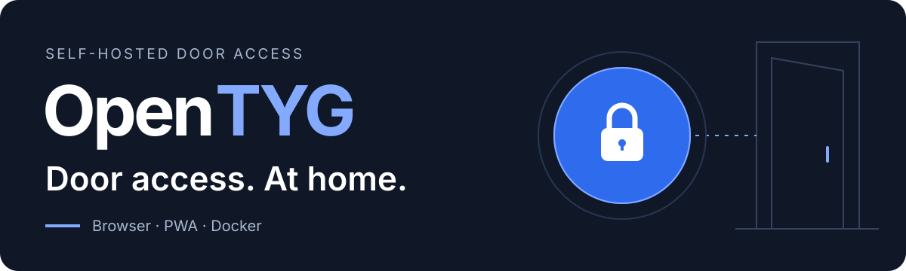
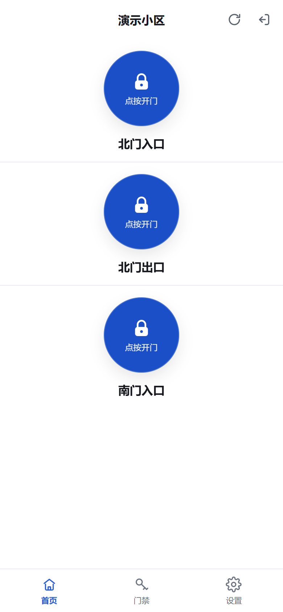
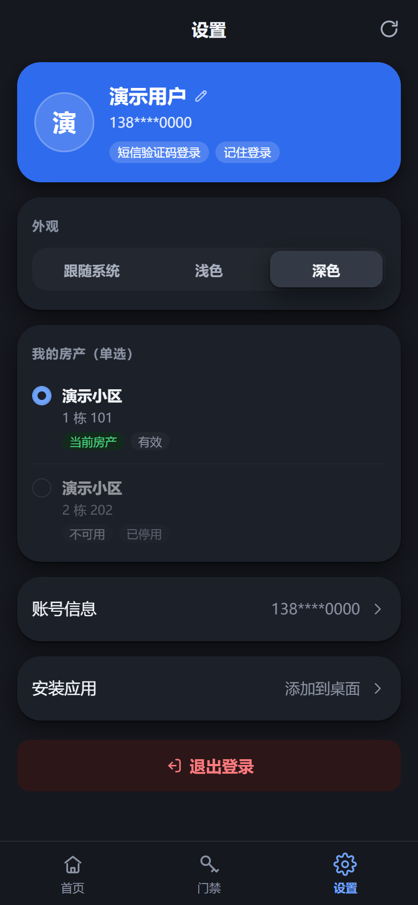
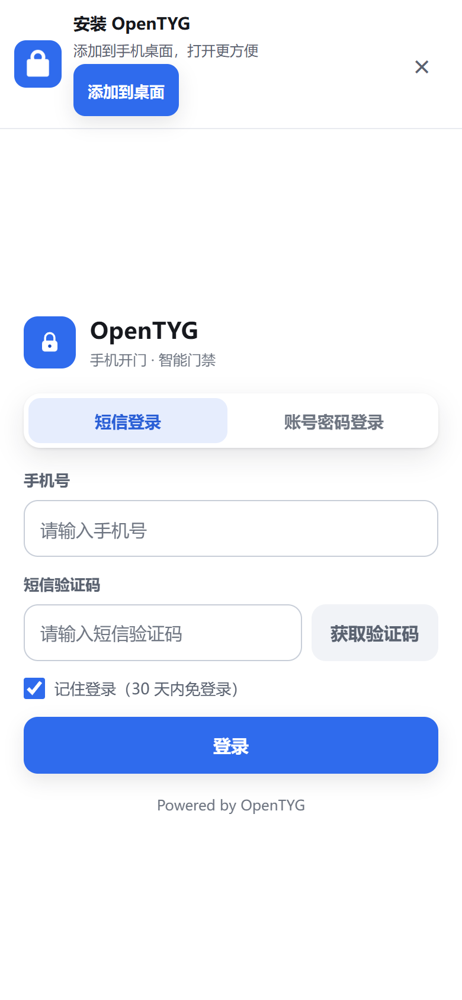
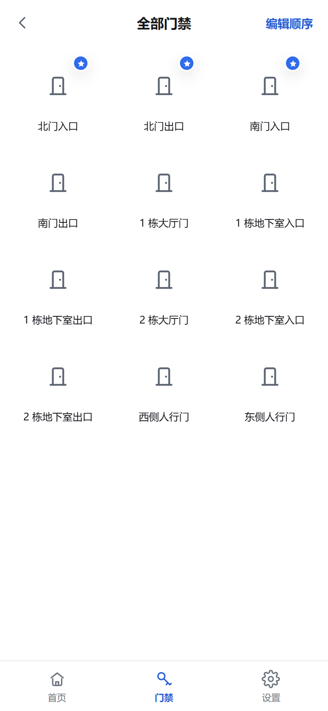
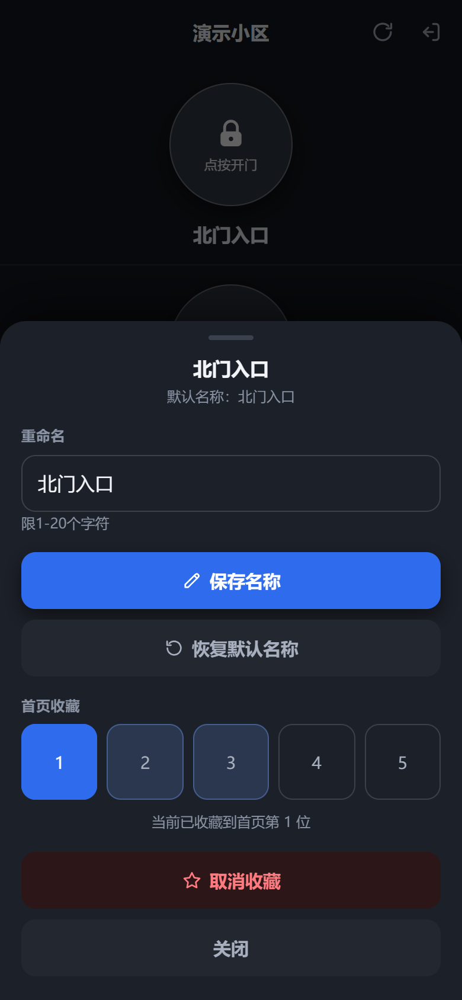

<p align="center">
  
</p>

<p align="center">
  <a href="https://github.com/zjmdong/OpenTYG/releases"></a>
  <a href="https://github.com/zjmdong/OpenTYG/actions/workflows/verify.yml"></a>
  <a href="LICENSE"></a>
</p>

<p align="center">
  <a href="README.md">简体中文</a> · <strong>English</strong><br>
  <a href="#quick-start">Quick start</a> · <a href="docs/README.en.md">Docs</a> · <a href="https://github.com/zjmdong/OpenTYG/releases">Releases</a> · <a href="https://github.com/zjmdong/OpenTYG/issues">Feedback</a>
</p>

**OpenTYG is a self-hosted web client for Taoyuangu door access.** Sign in with your existing account, keep frequently used doors on the home page, and tap to open from a mobile browser or home-screen app. Runs in one Docker container, without a separate database or frontend build.

> An unofficial project with no affiliation, partnership, or authorization relationship with Taoyuangu or its affiliates. An existing account and valid door permissions are required. Operate only devices you own or are explicitly authorized to use. Read the [disclaimer](DISCLAIMER.md).

## A look inside

<p align="center">
  <a href="docs/screenshots/home.png"></a>
  <a href="docs/screenshots/settings.png"></a>
</p>

<p align="center"><sub>Light home / dark settings · Fictional data from an isolated demo. Select an image for full size.</sub></p>

<details>
<summary>More screens: sign-in, all doors, names and favorites</summary>

<p align="center">
  <a href="docs/screenshots/login.png"></a>
  <a href="docs/screenshots/doors.png"></a>
  <a href="docs/screenshots/door-settings.png"></a>
</p>

Screenshots show the existing interface. The production app includes neither a demo service nor demo accounts.

</details>

## Everyday use

- **Your regular doors, easy to find**: up to five favorites, custom names, drag ordering, and property switching.
- **Browser or home-screen app**: touch layouts, light and dark themes, and PWA installation. The interface is currently in Simplified Chinese.
- **Stay signed in when you choose**: SMS, password, and device verification; remembered sessions last up to 30 days. If the platform expires them sooner, sign in again without losing favorites or settings.
- **Private state on your own server**: login restoration data and preferences are encrypted at rest. Upstream login tokens and door credentials never reach the browser.

Door access requires a network connection. Recovery retries preparation and failures confirmed to precede dispatch. If a command may have been sent but no acknowledgment arrives, the result is unknown and the app does not resend it automatically. A platform success response does not prove that the physical lock opened.

## Quick start

On a Linux server or NAS, prepare **Docker + the Docker Compose plugin**, **curl, OpenSSL, an HTTPS domain, and its certificate**, then run:

```sh
curl -fsSL -o install.sh https://raw.githubusercontent.com/zjmdong/OpenTYG/main/install.sh && \
  bash install.sh --lang=en
```

1. Enter your HTTPS address, data location, and internal port. Defaults usually work for the remaining prompts.
2. Point your HTTPS reverse proxy at the internal target printed by the installer.
3. Open the HTTPS address, sign in, and select an authorized property.

The installer creates Compose configuration and a first-time secret; no source checkout or `.env` is needed. Public images support **amd64 / arm64**. Keep the original data and secret when upgrading.

**[Full deployment guide →](docs/deployment.en.md)** · [Container image](https://github.com/zjmdong/OpenTYG/pkgs/container/opentyg) · [Manual configuration](docs/configuration.en.md)

**Install on your phone**: use the install option in a supported Android browser, or Safari's “Share → Add to Home Screen” on iPhone. The offline page only asks you to reconnect; it does not cache account data or queue door commands.

## Documentation and development

| Your task | Start here |
| --- | --- |
| Install, upgrade, migrate, or troubleshoot | [Deployment](docs/deployment.en.md) |
| Configure ports, secrets, and environment variables | [Configuration](docs/configuration.en.md) |
| Read the code and follow door operations | [Architecture](docs/architecture.en.md) |
| Understand sessions, privacy, and backups | [Privacy and operations](docs/security.en.md) |
| Change the web client or use its backend | [Backend API](docs/api.en.md) · [Contributing](CONTRIBUTING.en.md) |
| Build your own client on the platform protocol | [Standalone TYG SDK](https://github.com/zjmdong/OpenTYG/tree/opentyg-sdk) |

Built with **Node.js 24+ · native JavaScript / CSS · PWA**. One process serves static files and the API, with no npm runtime dependencies. An embedded, unofficial TYG Core SDK handles platform communication. The web app does not offer intercom features. [All documentation →](docs/README.en.md)

## Before deploying

- **HTTPS has a boundary**: the browser entry point requires HTTPS. Default upstream compatibility allows HTTP / WS; browser HTTPS does not encrypt plaintext traffic from the backend to the platform.
- **One data directory, one instance**: multiple processes or containers cannot share writes. Back up data, the original secret, and configuration together.
- **Existing permissions only**: this app grants no platform permissions and cannot guarantee continuing compatibility. See [privacy and operations](docs/security.en.md) and the [disclaimer](DISCLAIMER.md).

## Contribute

Use [Issues](https://github.com/zjmdong/OpenTYG/issues) for bugs and ideas, and read [Contributing](CONTRIBUTING.en.md) before submitting code. Remove private information from screenshots and logs. Report vulnerabilities privately through [SECURITY.md](SECURITY.md).

Source code is available under the [MIT License](LICENSE). Third-party services, accounts, devices, and trademarks are outside its scope.
