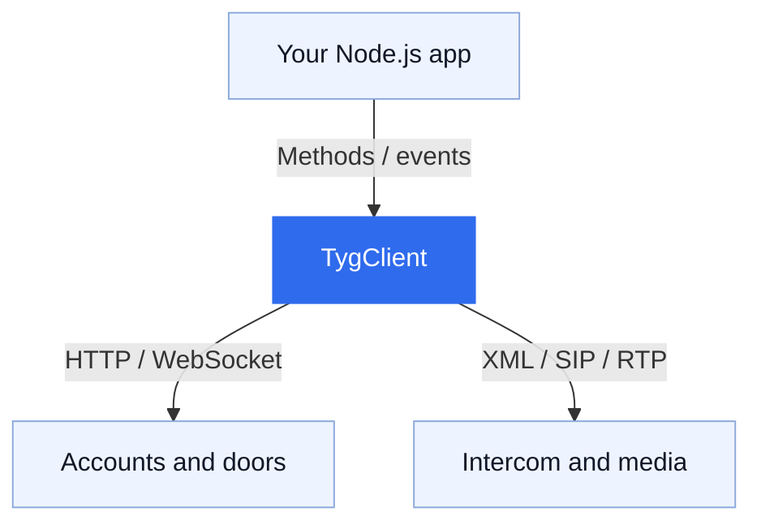

<p align="center">
  
</p>

<p align="center">
  <a href="package.json"></a>
  <a href="package.json"></a>
  <a href="LICENSE"></a>
</p>

<p align="center">
  <a href="README.md">简体中文</a> · <strong>English</strong><br>
  <a href="#quick-start">Quick start</a> · <a href="#how-it-works">How it works</a> · <a href="docs/README.en.md">Docs</a> · <a href="https://github.com/zjmdong/OpenTYG/tree/main">Web app</a>
</p>

**TYG Core SDK is a Taoyuangu protocol adapter for Node.js clients.** It covers service discovery, sign-in, door directories, and SIP intercom, with ES modules, TypeScript declarations, and protocol references. Build your own client here; for a deployable web app, use the [OpenTYG main branch](https://github.com/zjmdong/OpenTYG/tree/main).

> Unofficial, with no affiliation, partnership, or authorization relationship with Taoyuangu or its affiliates. Use only accounts and devices you own or are explicitly authorized to operate. References are based on Android client 1.3.8 and standalone SDK v0.3.4, without a platform stability guarantee. Read the [disclaimer](DISCLAIMER.md).

## Capabilities

| Area | Current scope |
| --- | --- |
| Accounts and permissions | Service discovery, human captcha verification, SMS/password sign-in, device verification, property authorization |
| Doors | WebSocket directories, current-context checks, a single command and its acknowledgment |
| Intercom | Personal XML configuration, UDP/IPv4 SIP outbound calls, monitoring, G.711 audio, H.264 reception |
| Integration | State/media events, type declarations, optional Windows DPAPI login storage |

One outbound call at a time. Incoming calls, TCP/TLS SIP, and SRTP are unsupported. Browsers cannot run the SIP UDP module directly. Verify speech and NAT traversal for your devices and network. [Full limits →](docs/intercom-protocol.md#implementation-limits)

## How it works



1. **Discover and sign in**: load dynamic service addresses and obtain account credentials through user verification.
2. **Select and prepare**: query authorized properties; fetch the door authcode and connect WebSocket in parallel, then download the directory.
3. **Act explicitly**: send a command only after the user selects a door from the current directory. Intercom separately needs personal configuration, SIP registration, and a user-initiated call.

Account tokens, property tokens, and door authcodes are not interchangeable. SDK references such as `household-1` and `door-1` belong to the current list, not persistent device identities. A lost acknowledgment after dispatch means an unknown result, without automatic replay.

**[Architecture →](docs/architecture.en.md)** · **[Door, intercom, and restoration flows →](docs/how-it-works.en.md)**

## Quick start

Requires **Node.js 22.4+**; Node.js 24 is recommended. Distributed through Git, not published to npm:

```sh
git clone --branch opentyg-sdk --single-branch https://github.com/zjmdong/OpenTYG.git OpenTYG-SDK
cd OpenTYG-SDK
npm ci --ignore-scripts
```

This example reads a directory without sending SMS or opening a door. Supply credentials from trusted input:

```js
import { TygClient } from './src/tyg-client.mjs';

async function listDoors(account, password) {
  const sdk = new TygClient({ lastLoginOs: '4' });
  try {
    await sdk.initialize();
    await sdk.loginPassword(account, password);
    const home = (await sdk.getHouseholds()).find(h => h.available);
    if (!home) throw new Error('No authorized property');
    return (await sdk.getDoors(home.id)).doors;
  } finally {
    sdk.close();
  }
}
```

The [runnable example](examples/list-doors.mjs) reads `TYG_ACCOUNT` and `TYG_PASSWORD` from a trusted environment and prints only the door count. It still contacts the real platform. `close()` releases local resources; use `logout()` for remote sign-out.

For another project, check out this branch and run `npm install --ignore-scripts /path/to/OpenTYG-SDK`, then import from `tyg-core-sdk`.

## Documentation

| Task | Start here |
| --- | --- |
| Understand modules and complete operations | [Architecture](docs/architecture.en.md) · [How it works](docs/how-it-works.en.md) |
| Use SDK methods, events, and errors | [SDK reference](docs/sdk-reference.en.md) · [Types](src/tyg-client.d.ts) |
| Implement platform HTTP / WebSocket | [Protocol reference](docs/platform-api.md) · [OpenAPI 3.1](docs/platform-openapi.json) |
| Integrate intercom, media, and NAT traversal | [XML / SIP / RTP](docs/intercom-protocol.md) |
| Design account protection and persistence | [Security and integration](docs/security.en.md) |
| Check provenance and licensing | [Provenance](docs/provenance.md) · [Third-party notices](THIRD_PARTY_NOTICES.md) |

Protocol field references use Chinese explanations with English headings and wire names. OpenAPI covers only ten JSON HTTP paths; WebSocket, XML, and SIP/RTP are documented separately. These are not the web app's `/api/*` routes. [All docs →](docs/README.en.md)

## Before integrating

- **Keep secrets in trusted processes**: `serializeLoginSession()` includes tokens and possibly the account password. Its output is unencrypted until a trusted store encrypts it.
- **Provide application protections**: account isolation, rate limits, browser sessions, CSRF, outbound host restrictions, and sanitized logging are integration responsibilities.
- **Respect transport boundaries**: defaults allow HTTP/WS; SIP Digest does not encrypt signaling or RTP. This is not end-to-end encryption.
- **Do not swap branch implementations**: main embeds changes for stable door IDs and host restrictions; this branch preserves the standalone v0.3.4 core.

Use [Issues](https://github.com/zjmdong/OpenTYG/issues) for ordinary problems, [Contributing](CONTRIBUTING.md) for changes, and [SECURITY.md](SECURITY.md) for private vulnerability reports. Original code is [MIT](LICENSE); dependencies retain their licenses. Official APKs, decompiled source, and real credentials are excluded.
