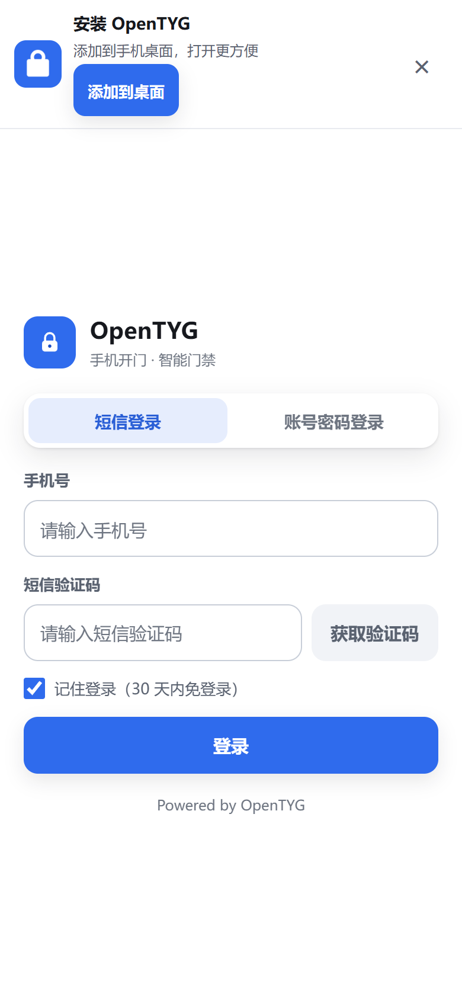
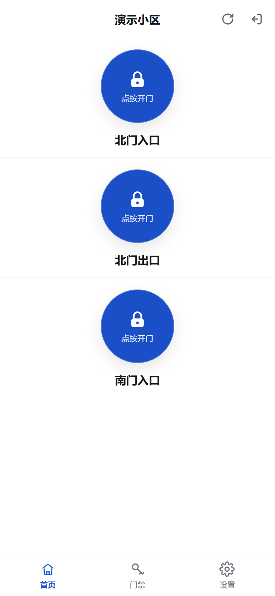
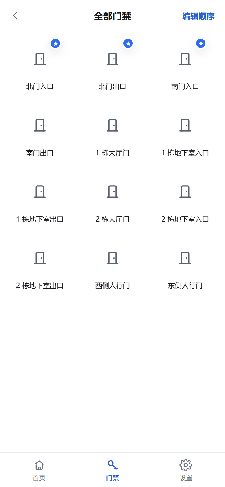
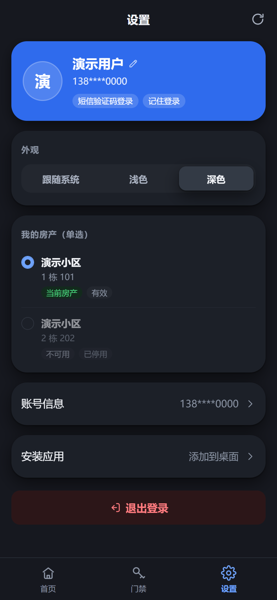
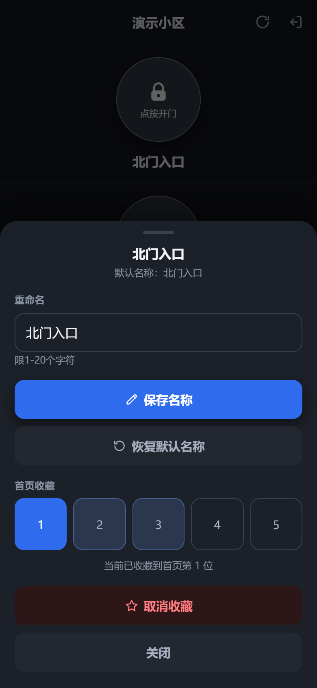
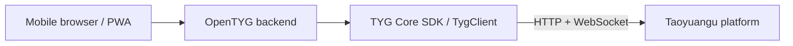

<div align="center">
  
  <h1>OpenTYG</h1>
  <p>Your existing Taoyuangu door access, in a browser and on your home screen.</p>
  <p>
    <a href="LICENSE"></a>
    
    
  </p>
  <p><a href="README.md">简体中文</a> · <strong>English</strong></p>
</div>

OpenTYG is a self-hosted web application for signing in with an existing Taoyuangu account, selecting a property, organizing frequently used doors, and requesting remote door access. One Node.js service hosts the frontend and backend. Deploy with Docker without a frontend build or a separate database.

**This application has no affiliation, partnership, or authorization relationship with Taoyuangu or its affiliates. It is not endorsed or supported by the official platform.** An existing account and valid door permissions are required; the application does not grant or bypass platform permissions. Use it responsibly, only with accounts and devices you own or are explicitly authorized to operate, and comply with applicable laws, platform terms, and property rules. Users are responsible for their actions and consequences, independently of the project author. To the extent permitted by applicable law, the author and contributors accept no liability arising from use or misuse. See the [disclaimer](DISCLAIMER.md).

The application interface is currently in Simplified Chinese; project documentation is available in Chinese and English.

## Features

- **Mobile experience**: touch-friendly layouts, light and dark themes, PWA installation, and home screen instructions for iPhone.
- **Account sign-in**: SMS verification, password login, platform-required device verification, and optional remembered sessions.
- **Properties and doors**: switch between authorized properties, drag to reorder, rename doors, and keep up to five favorites on the home screen.
- **Fast recovery**: display cached favorites promptly and retain a bounded login cache; one tap recovers pre-send connection failures while still checking current directory context and permissions.
- **Private storage**: encrypt remembered login state and preferences on the server; upstream login tokens and door credentials are never returned to the browser.
- **Simple deployment**: one container, one port, no npm runtime dependencies, a health check, and an HTTPS reverse proxy example.

## Screenshots

These screenshots were captured against an isolated offline demonstration service. All accounts, properties, and doors are fictional; no real residents or devices are shown. They display the existing interface. The demonstration service is not included in production deployments.

<table>
  <tr>
    <td align="center"><strong>Login and installation</strong><br></td>
    <td align="center"><strong>Favorite doors</strong><br></td>
    <td align="center"><strong>All doors</strong><br></td>
  </tr>
  <tr>
    <td align="center"><strong>Settings and properties</strong><br></td>
    <td align="center"><strong>Names and favorites</strong><br></td>
    <td align="center">Light / dark themes<br>Mobile browser / PWA</td>
  </tr>
</table>

## Built on the TYG SDK

OpenTYG communicates with the platform through **TYG Core SDK (`TygClient`)**. The SDK handles service configuration, image captchas, SMS and password login, property permissions, door authorization, and WebSocket directory and door messages. OpenTYG adds the web interface, browser sessions, authentication limits, encrypted storage, and user preferences.



TYG Core SDK is an **unofficial protocol adapter**, not an SDK supplied or maintained by Taoyuangu. The application embeds a server-oriented adaptation under `server/vendor/tyg-core-sdk/`, with host restrictions, stable door identifiers, and credential handling changes. Its source differs from the standalone SDK. The web application currently provides door access and does not expose the standalone SDK's intercom features.

For your own clients, see the [opentyg-sdk branch](https://github.com/zjmdong/OpenTYG/tree/opentyg-sdk) and its [Taoyuangu platform API reference](https://github.com/zjmdong/OpenTYG/blob/opentyg-sdk/docs/platform-api.md). That reference describes platform HTTP, WebSocket, XML, and SIP/RTP protocols. The `docs/api.md` file in this branch documents OpenTYG's own backend.

## Quick start

Install Docker and the Docker Compose plugin on your Linux server or NAS, then run:

```sh
curl -fsSL -o install.sh https://raw.githubusercontent.com/zjmdong/OpenTYG/main/install.sh && bash install.sh --lang=en
```

Follow the prompts for your HTTPS address, storage location, and internal port; Enter accepts defaults. The installer prepares permissions and a first-time secret, writes one `docker-compose.yml`, pulls the image, and checks startup. No source checkout or `.env` is needed. Existing configuration and secrets are preserved by default.

Then configure an HTTPS reverse proxy using the address and target printed by the installer. See the short [deployment guide](docs/deployment.en.md).

[Container package](https://github.com/zjmdong/OpenTYG/pkgs/container/opentyg) · [Installer](install.sh) · [Compose reference](docker-compose.yml). Images support **amd64 / arm64** and anonymous pulls. Preserve data and the original secret when upgrading.

## Install on a phone

Open the HTTPS site in a supported Android browser and use the installation entry or the browser's install menu. On iPhone, use Safari's **Share → Add to Home Screen**. Automatic installation prompts depend on the browser's own policies.

Once installed, the application opens in a standalone window from the home screen. Door access requires a network connection. The offline page only asks you to reconnect; it never caches account data or queues or replays door commands.

## Documentation

| Document | Contents |
| --- | --- |
| [Deployment](docs/deployment.en.md) / [中文](docs/deployment.md) | Docker, HTTPS, port forwarding, mobile installation, upgrades, and troubleshooting |
| [Configuration](docs/configuration.md) | Environment variables, runtime identity, upstream hosts, and local development |
| [Architecture](docs/architecture.md) | Browser, backend, platform services, and storage |
| [Privacy and operations](docs/security.md) | Credential lifecycle, encryption boundaries, backup, and recovery |
| [OpenTYG backend API](docs/api.md) | This application's sessions, directory context, door operations, and errors |
| [TYG SDK and platform APIs](https://github.com/zjmdong/OpenTYG/tree/opentyg-sdk) | Standalone SDK, platform protocols, and development |
| [Disclaimer](DISCLAIMER.md) | Unofficial status, responsible use, and authorization boundaries |

## Security and operational boundaries

Production browser connections require HTTPS. The default upstream configuration permits HTTP/WS for compatibility. Public HTTPS protects the browser-to-proxy connection; it cannot encrypt backend communication with an HTTP upstream. Evaluate this boundary for your network and restrict the upstream host list. Disable HTTP compatibility if a verified HTTPS/WSS upstream becomes available.

A successful platform acknowledgment does not guarantee that a physical lock opened. A connection loss or timeout after sending produces an unknown result, and the application does not resend automatically. Check the door before deciding whether to try again.

Storage is designed for a single instance. Do not run multiple processes or containers against the same data directory. Never upload `data/`, `secrets/`, `.env`, certificate private keys, or runtime logs to a repository.

## Contributing

Use [Issues](https://github.com/zjmdong/OpenTYG/issues) for ordinary bug reports and suggestions, and Pull Requests for contributions. Read [CONTRIBUTING.md](CONTRIBUTING.md) first. For security concerns, follow [SECURITY.md](SECURITY.md) and do not publish account details, tokens, or sensitive reproduction information.

## License

OpenTYG source code is distributed under the [MIT License](LICENSE). This license does not cover third-party platform services, accounts, door hardware, or trademarks.
