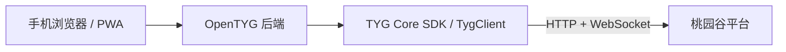

<div align="center">
  
  <h1>OpenTYG</h1>
  <p>把已有的桃园谷门禁权限，带到浏览器和手机主屏幕。</p>
  <p>
    <a href="LICENSE"></a>
    
    
  </p>
  <p><strong>简体中文</strong> · <a href="README.en.md">English</a></p>
</div>

OpenTYG 是一个可自行部署的移动端网页应用，支持通过已有桃园谷账号登录、选择房产、管理常用门禁和远程开门。前端与后端由一个 Node.js 服务提供，通过 Docker 即可部署，无需前端构建或额外数据库。

**本应用与桃园谷官方及其关联方无任何隶属、合作或授权关系，未获得官方认可，也不由官方提供技术支持。** 使用前需要已有账号及有效门禁权限；应用不会授予或绕过平台权限。请负责任地使用，仅操作本人或已获明确授权的账号和设备，并遵守适用法律、平台规则和物业规定。用户的使用行为及其后果由用户自行承担，与项目作者无关；在适用法律允许的范围内，作者及贡献者不承担因使用或滥用本项目产生的责任。详见 [免责声明](DISCLAIMER.md)。

当前应用界面为简体中文，项目文档提供中英双语。

## 功能

- **手机使用**：适配触屏、深浅色主题，支持安装为 PWA；iPhone 提供添加到主屏幕的操作说明。
- **账号登录**：短信验证码、密码登录及平台要求的设备验证；可选择记住登录。
- **房产与门禁**：切换有权限的房产、拖动排序、自定义名称，首页最多收藏 5 个门禁。
- **连接准备**：登录后及回到前台时提前准备门禁连接，发送开门指令前检查目录和权限。
- **私有存储**：服务端加密保存记住的登录状态和用户偏好，浏览器不接收上游登录令牌或开门凭据。
- **简单部署**：单容器、单端口、无 npm 运行时依赖；附带健康检查和 HTTPS 反向代理示例。

## 界面预览

以下截图使用隔离的离线演示服务生成，账号、房产和门禁名称均为虚构数据，不涉及真实住户或设备。截图展示现有界面，演示服务不包含在生产部署中。

<table>
  <tr>
    <td align="center"><strong>登录与手机安装</strong><br></td>
    <td align="center"><strong>首页收藏</strong><br></td>
    <td align="center"><strong>全部门禁</strong><br></td>
  </tr>
  <tr>
    <td align="center"><strong>设置与房产</strong><br></td>
    <td align="center"><strong>名称与收藏位次</strong><br></td>
    <td align="center">浅色 / 深色主题<br>手机浏览器 / PWA</td>
  </tr>
</table>

## 底层：TYG SDK

OpenTYG 的平台通信由 **TYG Core SDK（`TygClient`）** 实现。SDK 封装桃园谷平台的服务配置、图形验证码、短信与密码登录、房产权查询、门禁鉴权，以及 WebSocket 门目录下载和开门消息。OpenTYG 在这一层之上提供网页界面、账号会话管理、认证限流、加密存储和用户偏好。



TYG Core SDK 是本项目的**非官方协议适配实现**，不是桃园谷官方提供或维护的 SDK。网页应用在 `server/vendor/tyg-core-sdk/` 内嵌了用于服务端部署的适配版本，包含主机限制、稳定门禁标识和凭据处理等调整；它与独立 SDK 的源码版本不完全相同。网页应用目前提供门禁功能，没有开放独立 SDK 中的对讲功能。

如果你希望开发自己的客户端，可查看独立的 [opentyg-sdk 分支](https://github.com/zjmdong/OpenTYG/tree/opentyg-sdk)，以及其中的 [桃园谷平台接口参考](https://github.com/zjmdong/OpenTYG/blob/opentyg-sdk/docs/platform-api.md)。该文档描述平台 HTTP、WebSocket、XML 和 SIP/RTP 协议；本文档目录中的 `docs/api.md` 描述的是 OpenTYG 自己的后端接口。

## 快速开始

在 Linux 服务器或 NAS 上启用 Docker 和 Docker Compose 插件，然后执行：

```sh
curl -fsSL -o install.sh https://raw.githubusercontent.com/zjmdong/OpenTYG/main/install.sh && bash install.sh
```

按提示填写 HTTPS 地址、数据目录和内网端口，其余通常直接回车。脚本自动准备权限、生成首次密钥、写入一个 `docker-compose.yml`、拉取镜像并检查启动；无需源码和 `.env`。已有配置和密钥默认保留。

最后在反向代理中填入脚本显示的公网地址与内网目标。步骤见精简的 [部署指南](docs/deployment.md)。

[公开镜像](https://github.com/zjmdong/OpenTYG/pkgs/container/opentyg) · [安装脚本](install.sh) · [Compose 参考](docker-compose.yml)。支持 **amd64 / arm64**，无需登录。升级保留数据和原密钥。

## 手机安装

通过 HTTPS 打开应用后，支持安装提示的 Android 浏览器可使用安装入口；也可从浏览器菜单选择安装。iPhone 使用 Safari 的“分享 → 添加到主屏幕”。浏览器是否自动显示安装提示由其自身策略决定。

安装后可从主屏幕启动独立窗口。开门需要联网；离线页只提示恢复连接，不缓存账号数据、不排队或重放开门指令。

## 文档

| 文档 | 内容 |
| --- | --- |
| [部署指南](docs/deployment.md) / [English](docs/deployment.en.md) | Docker、HTTPS、端口映射、手机安装、升级与排障 |
| [配置参考](docs/configuration.md) | 环境变量、运行用户、上游地址与本机开发 |
| [架构说明](docs/architecture.md) | 浏览器、后端、平台服务和数据存储 |
| [隐私与运维](docs/security.md) | 凭据生命周期、加密边界、备份与恢复 |
| [OpenTYG 后端 API](docs/api.md) | 本应用的会话、目录、门禁操作和错误处理 |
| [TYG SDK 与平台接口](https://github.com/zjmdong/OpenTYG/tree/opentyg-sdk) | 独立 SDK、平台通信协议和二次开发 |
| [免责声明](DISCLAIMER.md) | 非官方项目声明、使用责任与授权边界 |

## 安全与使用边界

浏览器到本服务的生产连接必须使用 HTTPS。默认上游配置兼容 HTTP／WS；公网 HTTPS 只保护浏览器到反向代理这一段，无法加密后端到 HTTP 上游的通信。请按你的网络环境评估这一边界，限制上游主机名单；若上游提供经验证的 HTTPS／WSS，再关闭 HTTP 兼容。

收到平台成功回执不等于物理门锁一定开启。发送后断网或超时会显示结果未知，应用不会自动重发；请确认现场状态，再决定是否重新操作。

本项目采用单实例文件存储，不支持多个进程或容器同时读写同一数据目录。不要把 `data/`、`secrets/`、`.env`、证书私钥或运行日志上传到代码仓库。

## 参与项目

欢迎通过 [Issues](https://github.com/zjmdong/OpenTYG/issues) 报告普通问题或提出建议，通过 Pull Request 贡献修改。提交前请阅读 [贡献指南](CONTRIBUTING.md)。安全问题请参照 [SECURITY.md](SECURITY.md)，不要公开账号、令牌或可直接复现的敏感信息。

## 许可证

OpenTYG 的源代码以 [MIT 许可证](LICENSE) 发布。第三方平台服务、账号、门禁设备及商标不属于本项目的授权范围。
