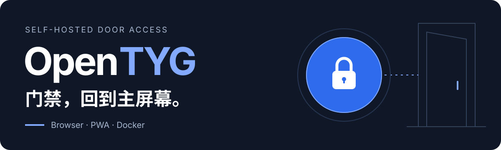
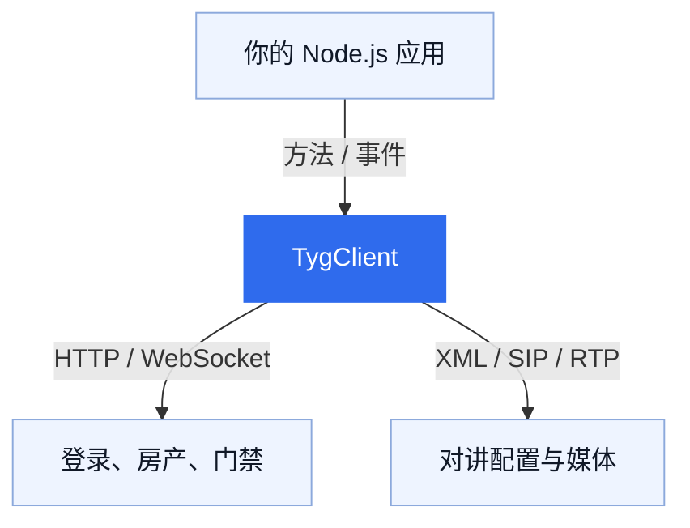

<p align="center">
  
</p>

<p align="center">
  <a href="package.json"></a>
  <a href="package.json"></a>
  <a href="LICENSE"></a>
</p>

<p align="center">
  <strong>简体中文</strong> · <a href="README.en.md">English</a><br>
  <a href="#快速接入">快速接入</a> · <a href="#how-it-works">How it works</a> · <a href="docs/README.md">文档</a> · <a href="https://github.com/zjmdong/OpenTYG/tree/main">网页应用</a>
</p>

**TYG Core SDK 是供 Node.js 客户端使用的桃园谷协议适配库。** 从服务发现、账号登录、门禁目录到 SIP 对讲，提供 ES modules、TypeScript 声明和平台协议参考。适合开发自己的客户端；想直接部署网页，请看 [OpenTYG 主分支](https://github.com/zjmdong/OpenTYG/tree/main)。

> 非官方项目，与桃园谷及其关联方无隶属、合作或授权关系。仅使用本人或明确获授权的账号与设备。文档基于 Android 客户端 1.3.8 与独立 SDK v0.3.4，不代表平台稳定性承诺。详见 [免责声明](DISCLAIMER.md)。

## 能做什么

| 能力 | 当前范围 |
| --- | --- |
| 账号与权限 | 服务发现、人工图形验证、短信/密码登录、设备验证、房产鉴权 |
| 门禁 | WebSocket 目录下载、当前目录校验、单次开门与回执 |
| 对讲 | XML 个人配置、UDP/IPv4 SIP 出呼、监看、G.711 音频、H.264 接收 |
| 集成 | 状态/媒体事件、类型声明、可选 Windows DPAPI 登录存储 |

仅一个并发出呼；不支持来电接听、TCP/TLS SIP 或 SRTP。浏览器不能直接运行 SIP UDP 模块，语音与 NAT 穿透需按设备和网络验证。[完整边界 →](docs/intercom-protocol.md#implementation-limits)

## How it works



1. **发现与登录**：获取动态服务地址，通过用户验证取得登录凭据。
2. **选择与准备**：查询有权限的房产；并行获取门禁 authcode 和建立 WebSocket，再下载目录。
3. **明确操作**：用户选择当前目录中的门后才发送指令；对讲另行获取个人配置、注册 SIP，再由用户发起出呼。

登录 token、房产 token 和门禁 authcode 各有用途，不能互换。SDK 的 `household-1`、`door-1` 是本次列表引用，不是持久设备 ID。指令发出后丢失回执表示结果未知，不自动重发。

**[架构与模块 →](docs/architecture.md)** · **[开门、对讲和恢复流程 →](docs/how-it-works.md)**

## 快速接入

需要 **Node.js 22.4+**，建议 Node.js 24。通过 Git 分支分发，未发布到 npm：

```sh
git clone --branch opentyg-sdk --single-branch https://github.com/zjmdong/OpenTYG.git OpenTYG-SDK
cd OpenTYG-SDK
npm ci --ignore-scripts
```

下面只读取目录，不发送短信或开门。账号、密码由调用方从安全输入取得：

```js
import { TygClient } from './src/tyg-client.mjs';

async function listDoors(account, password) {
  const sdk = new TygClient({ lastLoginOs: '4' });
  try {
    await sdk.initialize();
    await sdk.loginPassword(account, password);
    const home = (await sdk.getHouseholds()).find(h => h.available);
    if (!home) throw new Error('No authorized property');
    return (await sdk.getDoors(home.id)).doors;
  } finally {
    sdk.close();
  }
}
```

[可运行示例](examples/list-doors.mjs) 从可信环境读取 `TYG_ACCOUNT` 和 `TYG_PASSWORD`，只输出门禁数量。它仍会访问真实平台；`close()` 释放本地资源，远程退出使用 `logout()`。

在其他项目中，先检出本分支，再用 `npm install --ignore-scripts /path/to/OpenTYG-SDK` 安装本地包，即可从 `tyg-core-sdk` 导入。

## 文档

| 想做什么 | 从这里开始 |
| --- | --- |
| 理解模块与一次完整操作 | [架构](docs/architecture.md) · [How it works](docs/how-it-works.md) |
| 调用 SDK、处理事件与错误 | [SDK 使用参考](docs/sdk-reference.md) · [类型声明](src/tyg-client.d.ts) |
| 自行实现平台 HTTP / WebSocket | [协议参考](docs/platform-api.md) · [OpenAPI 3.1](docs/platform-openapi.json) |
| 接入对讲、音视频与 NAT 穿透 | [XML / SIP / RTP 协议](docs/intercom-protocol.md) |
| 设计账号保护和持久化 | [安全与集成](docs/security.md) |
| 核对来源与许可 | [来源说明](docs/provenance.md) · [第三方许可](THIRD_PARTY_NOTICES.md) |

OpenAPI 仅描述 10 个 JSON HTTP 路径；WebSocket、XML 和 SIP/RTP 另有协议文档。它们不是网页应用的 `/api/*` 接口。[全部文档 →](docs/README.md)

## 集成前须知

- **秘密留在可信进程**：`serializeLoginSession()` 含登录 token 和可能的账户密码，输出未加密；持久化前交给可信加密存储。
- **应用保护由你提供**：账号隔离、限流、浏览器会话、CSRF、出站主机限制和日志脱敏不由 SDK 完整提供。
- **网络有边界**：默认兼容 HTTP/WS；SIP Digest 不加密信令或 RTP。不要宣称全链路加密。
- **两个分支不可直接替换**：main 内嵌 SDK 有稳定门 ID、主机限制等适配；本分支保留独立 v0.3.4 核心源码。

普通问题通过 [Issues](https://github.com/zjmdong/OpenTYG/issues) 反馈，修改请看 [贡献指南](CONTRIBUTING.md)，漏洞按 [SECURITY.md](SECURITY.md) 私下报告。原创代码采用 [MIT](LICENSE)，第三方依赖保留各自许可证；不分发官方 APK、反编译源码或真实凭据。
