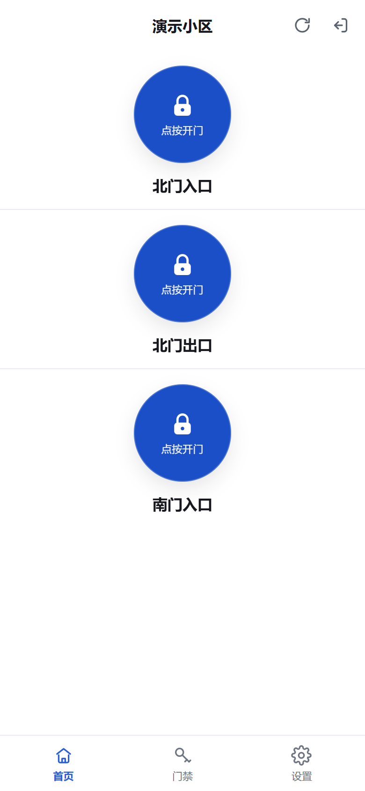
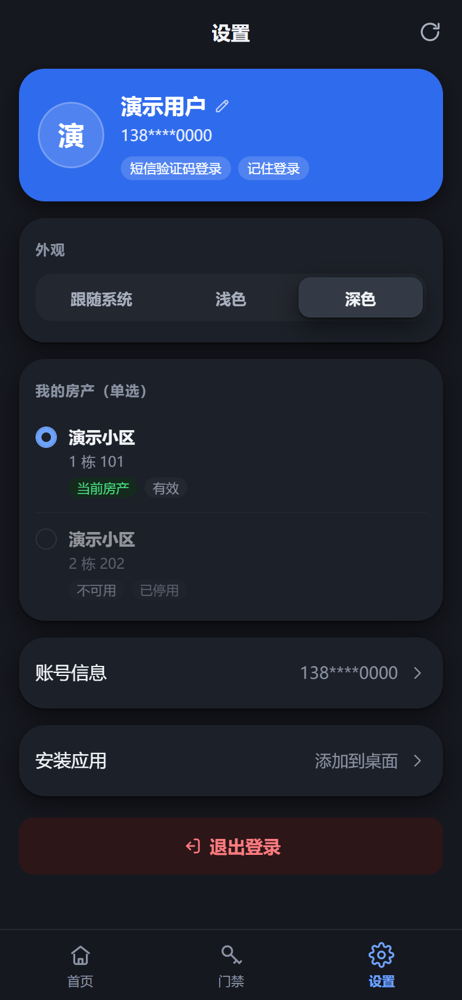
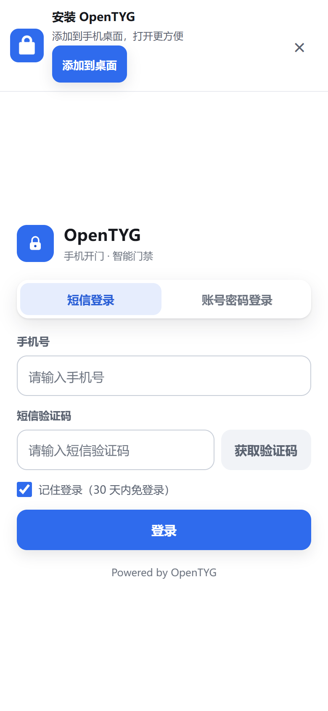
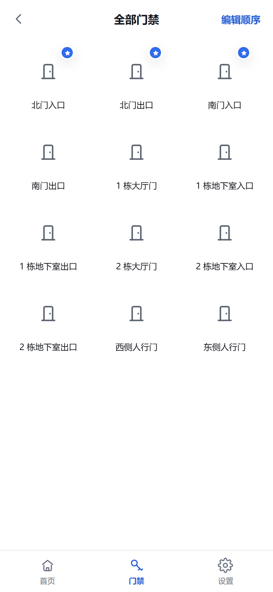
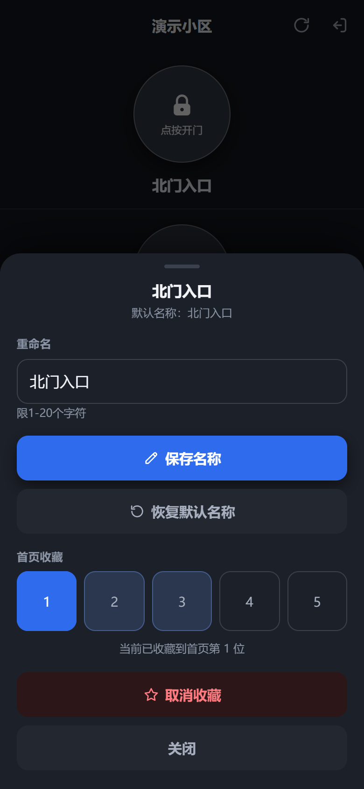
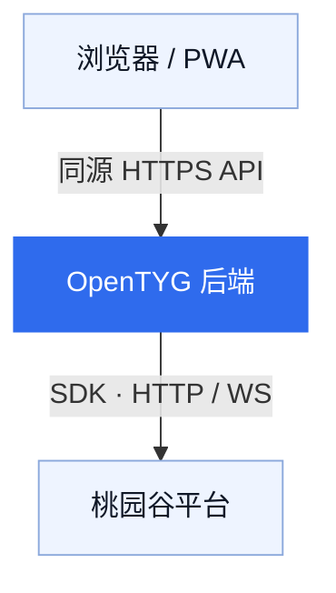

<p align="center">
  
</p>

<p align="center">
  <a href="https://github.com/zjmdong/OpenTYG/releases"></a>
  <a href="https://github.com/zjmdong/OpenTYG/actions/workflows/verify.yml"></a>
  <a href="LICENSE"></a>
</p>

<p align="center">
  <strong>简体中文</strong> · <a href="README.en.md">English</a><br>
  <a href="#快速开始">快速开始</a> · <a href="docs/README.md">文档</a> · <a href="https://github.com/zjmdong/OpenTYG/releases">版本下载</a> · <a href="https://github.com/zjmdong/OpenTYG/issues">反馈</a>
</p>

**OpenTYG 是可自行部署的桃园谷门禁网页客户端。** 用已有账号登录，把常用门禁放到首页，在手机浏览器或主屏幕应用中点按开门。一个 Docker 容器即可运行，无需额外数据库或前端构建。

> 非官方项目，与桃园谷及其关联方无隶属、合作或授权关系。使用前须有有效账号和门禁权限，仅操作本人或明确获授权的设备。详见 [免责声明](DISCLAIMER.md)。

## 界面一览

<p align="center">
  <a href="docs/screenshots/home.png"></a>
  <a href="docs/screenshots/settings.png"></a>
</p>

<p align="center"><sub>浅色首页 / 深色设置 · 截图为隔离演示环境中的虚构数据，点图查看原图。</sub></p>

<details>
<summary>更多界面：登录、全部门禁、名称与收藏</summary>

<p align="center">
  <a href="docs/screenshots/login.png"></a>
  <a href="docs/screenshots/doors.png"></a>
  <a href="docs/screenshots/door-settings.png"></a>
</p>

截图展示现有界面；生产部署不包含演示服务或演示账号。

</details>

## 日常使用

- **常用门禁，一眼找到**：首页最多 5 个收藏；支持重命名、拖动排序和房产切换。
- **手机浏览器，也能装到主屏幕**：触屏布局、深浅色主题、PWA 安装。界面目前为简体中文。
- **登录状态，按需保留**：短信、密码及设备验证；记住登录最长 30 天，平台提前失效时重新登录即可，收藏和设置保留。
- **数据留在自己的服务端**：登录恢复数据和偏好加密保存，上游登录令牌与开门凭据不下发给浏览器。

开门需要联网。连接恢复只重试准备阶段和确认尚未发送的失败；指令可能已发出却没有回执时，会提示结果未知，不自动重发。平台成功回执也不等于物理门锁一定开启。

## How it works



1. **登录与选房产**：浏览器拿到本服务的会话 Cookie，上游凭据留在后端。
2. **准备门禁**：后端查询权限、获取鉴权和目录；首页可先显示旧收藏，但显示缓存不授予开门权限。
3. **点按一次**：校验当前目录和稳定门 ID，必要时恢复连接，再发送指令。可能已发送的指令不会自动重发。

HTTPS 在反向代理终止，代理到服务走受控内网 HTTP；默认上游 HTTP/WS 仍可能为明文。**[架构与模块 →](docs/architecture.md)** · **[开门时序、重试与会话恢复 →](docs/how-it-works.md)**

## 快速开始

准备一台 Linux 服务器或 NAS，安装 **Docker + Docker Compose 插件**，备好 **curl、OpenSSL、HTTPS 域名及证书**，然后运行：

```sh
curl -fsSL -o install.sh https://raw.githubusercontent.com/zjmdong/OpenTYG/main/install.sh && \
  bash install.sh
```

1. 按向导填写 HTTPS 地址、数据目录和内网端口，其余通常使用默认值。
2. 将 HTTPS 反向代理指向脚本显示的内网目标。
3. 打开 HTTPS 地址，登录已有账号，选择有权限的房产。

安装向导生成 Compose 配置和首次密钥，无需源码或 `.env`。公开镜像支持 **amd64 / arm64**；升级时保留原数据和密钥。

**[完整部署指南 →](docs/deployment.md)** · [容器镜像](https://github.com/zjmdong/OpenTYG/pkgs/container/opentyg) · [手动配置](docs/configuration.md)

**装到手机**：Android 在支持的浏览器中选择安装；iPhone 用 Safari 的「分享 → 添加到主屏幕」。离线页仅提示恢复连接，不缓存账号数据或排队开门。

## 文档与开发

| 想做什么 | 从这里开始 |
| --- | --- |
| 安装、升级、迁移或排障 | [部署指南](docs/deployment.md) |
| 调整端口、密钥与环境变量 | [配置参考](docs/configuration.md) |
| 阅读源码、理解开门流程 | [架构说明](docs/architecture.md) · [How it works](docs/how-it-works.md) |
| 了解登录状态、隐私与备份边界 | [隐私与运维](docs/security.md) |
| 修改网页或接入本应用后端 | [后端 API](docs/api.md) · [贡献指南](CONTRIBUTING.md) |
| 用底层协议开发自己的客户端 | [独立 TYG SDK](https://github.com/zjmdong/OpenTYG/tree/opentyg-sdk) |

技术栈：**Node.js 24+ · 原生 JavaScript / CSS · PWA**。一个进程提供静态页面和 API，无 npm 运行时依赖；平台通信由内嵌的非官方 TYG Core SDK 处理。网页应用目前不提供对讲功能。[查看全部文档 →](docs/README.md)

## 部署前须知

- **HTTPS 有边界**：浏览器入口须使用 HTTPS；默认上游兼容 HTTP / WS，浏览器 HTTPS 不会加密后端到平台的明文通信。
- **一个数据目录，一个实例**：文件存储不支持多个进程或容器共享写入；备份须同时保留数据、原密钥及配置。
- **使用已有权限**：本项目不授予平台权限，也不保证上游服务持续兼容。完整说明见 [隐私与运维](docs/security.md) 和 [免责声明](DISCLAIMER.md)。

## 参与项目

普通问题和建议请提交 [Issue](https://github.com/zjmdong/OpenTYG/issues)，代码修改请先阅读 [贡献指南](CONTRIBUTING.md)。截图和日志请脱敏；安全问题按 [SECURITY.md](SECURITY.md) 私下报告。

源代码采用 [MIT 许可证](LICENSE)。第三方平台服务、账号、设备与商标不在本项目授权范围内。
