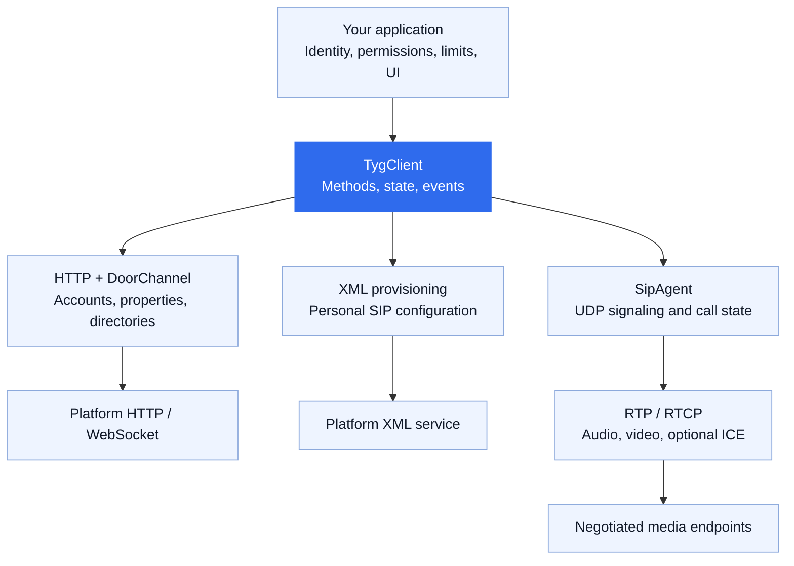

# Architecture

[Docs](README.en.md) / Architecture · [简体中文](architecture.md)

The SDK runs inside a trusted Node.js process and does not start an HTTP server. Use one `TygClient` per account; your application binds users to instances and current configurations.

## Modules and external services

Door access and intercom share account setup, but use distinct protocols, credentials, and lifecycles. HTTP sign-in is not SIP registration; an accepted SIP call is not proof of playable media.

## Source map

| File | Responsibility |
| --- | --- |
| [src/tyg-client.mjs](../src/tyg-client.mjs) | Discovery, sign-in, properties, DoorChannel, operation exclusion, intercom entry points |
| [src/tyg-client.d.ts](../src/tyg-client.d.ts) | Signatures, directories, states, errors, media events |
| [src/intercom/provision.mjs](../src/intercom/provision.mjs) | XML authentication, cookies, personal configuration, PHONE_BOOK |
| [src/intercom/sip.mjs](../src/intercom/sip.mjs) | REGISTER, Digest, INVITE, CANCEL/BYE, dialog state |
| [src/intercom/media.mjs](../src/intercom/media.mjs) | SDP, G.711, H.264 reception, RTP/RTCP, media events |
| [src/intercom/ice.mjs](../src/intercom/ice.mjs), [vendor/ice/wrapper.mjs](../vendor/ice/wrapper.mjs) | Optional ICE and the pinned werift-ice dependency |
| [src/intercom/network.mjs](../src/intercom/network.mjs) | SIP proxy resolution, local routes, Fake-IP fallback |
| [src/login-store.mjs](../src/login-store.mjs) | Optional current-user Windows DPAPI storage |

## State, concurrency, and identity

- `initialize()` discovers services. `getState()` reads memory without renewal or sign-in.
- Core operations use per-instance exclusion; conflicts return `BUSY`. Each door channel waits for one business response, avoiding mismatched replies without a general requestId.
- `getHouseholds()` clears the current door connection and directory. `getDoors()` creates a new `directoryId`.
- `household-1` and `door-1` belong to the current list. After reload, obtain a selection from new configuration rather than mapping old indexes to new devices.
- `callIntercom()` returns startup state immediately and progresses through events. One outbound call is allowed per instance. Hangup is independent of the background call task.

[How it works](how-it-works.en.md) follows these contracts through door commands, calls, and restoration.

## Transport and secrets

| Channel | Credentials or data | Integration responsibility |
| --- | --- | --- |
| Account/property HTTP | Passwords, verification codes, sessionToken, householdToken | Restrict destinations, validate certificates, protect responses |
| Door WebSocket | householdToken in URL, authcode in messages | Avoid credential URL logging; never replay sent commands |
| XML / SIP | XML cookies, account-password digests, personal SIP secrets | Trusted configuration, authorized devices, signaling checks |
| RTP / RTCP / ICE | Media, candidates, ICE/TURN credentials | User authorization, negotiated endpoints, reachability |
| Serialized login | Tokens, device identity, possibly account password | Encrypt before persistence; manage keys and retention |

`fetchImpl` controls HTTP only, not native WebSocket, DNS, or UDP. Default HTTP/WS and SIP/RTP UDP are not end-to-end encryption. DPAPI applies only to the current Windows user, not other operating systems. See [Security and integration](security.en.md).

## Compared with main

| Area | Standalone SDK | main web app |
| --- | --- | --- |
| Runtime | Node.js library, no public API | Web client and API in one process |
| Door references | Temporary current-list references | IDs derived from stable platform identifiers |
| Sessions/storage | Integrator-owned; serialization and optional DPAPI | Browser sessions, encrypted files, expiry cleanup |
| Recovery | Caller arranges directory reload | Bounded automatic preparation with a dispatch boundary |
| Intercom | XML, SIP, and media interfaces | Not exposed by the web app |

Core source hashes are recorded in [source-manifest.json](source-manifest.json). Do not replace main's vendor directory directly with this branch.
