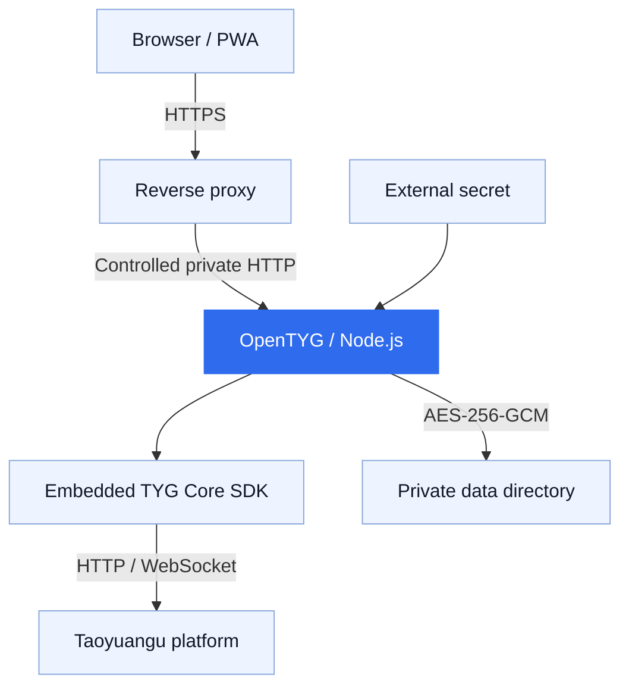

# Architecture

[Docs](README.en.md) / Architecture · [简体中文](architecture.md)

One Node.js process serves the web client and API. The browser talks only to this service; the backend handles platform sign-in, door authorization, and WebSocket connections.

## Data flow

The frontend uses native HTML, CSS, ES modules, and hash routes. No bundler, separate database, or npm runtime dependencies are required. The reverse proxy terminates TLS. Upstream HTTP / WebSocket compatibility in this diagram does not encrypt transport; see [network boundaries](security.en.md#network-and-launch-checks).

## Source map

| Path | Responsibility |
| --- | --- |
| `server/index.mjs` | Startup configuration and shutdown |
| `server/app.mjs` | HTTP routes, validation, sign-in, and user operations |
| `server/service.mjs` | Account session pool, directories, recovery, and door commands |
| `server/vendor/tyg-core-sdk/src/` | Unofficial platform protocol adapter |
| `server/store.mjs`, `persistence.mjs` | Encryption, atomic writes, and syncing |
| `server/session.mjs`, `auth-limits.mjs` | Browser sessions and persistent authentication limits |
| `server/request-security.mjs`, `frontend-policy.mjs` | Host, Origin, cookies, and frontend policies |
| `server/prefs.mjs` | Per-user/property favorites, ordering, and names |
| `web/js/pages/`, `web/css/` | Pages, interactions, and themes |
| `web/sw.js`, `web/js/pwa.js` | Offline information and PWA installation |
| `deploy/` | Health probe and Nginx example |

## A door operation

See [How it works](how-it-works.en.md) for sequence and decision diagrams. The steps below summarize source responsibilities.

1. The browser submits the door ID, `householdId`, and `directoryId`.
2. The backend checks the session, selected property, directory context, cooldown, and per-account serialization.
3. If reconnection is needed, it verifies property permissions and resolves the same stable door ID.
4. It sends the command and waits for acknowledgment; an uncertain result returns `OPEN_RESULT_UNKNOWN`.

Door and property IDs derive from stable platform identifiers, not array positions. Automatic recovery preserves UI context only when the property and full device/configuration fingerprint are unchanged. Explicit `refresh=1` creates a new context. A removed door is never replaced with another device.

**Retries stop at the dispatch boundary.** Preparation and confirmed pre-send failures allow at most three attempts within a shared budget of approximately 2.9 seconds. Individual stages have a default no-response timeout of about 950ms. Once a command may have been sent, it gets one five-second acknowledgment window and is never resent automatically. These are timeout settings, not latency guarantees.

Startup and foreground events coalesce warm-up requests. A warm tap can submit directly; after an explicit stale-context rejection, the frontend may refresh and continue the original tap. API clients should follow the [error contract](api.en.md#error-handling) when context changes.

## Sessions and storage

- Each account shares one upstream session in the process, with serialized operations. Logout revokes all of that account's browser sessions on this service while retaining preferences.
- Healthy directories and permission checks are reused for up to approximately 60 seconds. Sockets close after 30 idle minutes.
- Login/configuration state is bounded to approximately 24 idle hours and 200 accounts, with possible earlier LRU eviction. Caching never extends browser-session authority.
- Storage has no cross-process lock. Only one instance may write a data directory. Restart after manually replacing files.

The home page may show the current cookie owner's previous favorites before reconnecting. Display data grants no door permissions. See [credential lifecycle](security.en.md#credential-lifecycle) for remembered login, account expiry, and property-token refresh.

## PWA and SDK boundaries

The Service Worker caches only public offline information and a few supporting assets. The application shell, API, captchas, accounts, and commands are not cached offline. Commands are never queued or replayed.

The embedded SDK is unofficial and includes deployment-specific changes from the [standalone SDK branch](https://github.com/zjmdong/OpenTYG/tree/opentyg-sdk). Intercom modules are internal dependencies, not a web feature. The platform remains authoritative for accounts, properties, door permissions, and device state.
