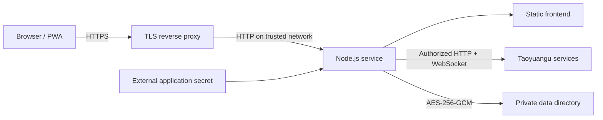

# 架构 / Architecture

[中文 README](../README.md) · [English README](../README.en.md)

## 数据流 / Data flow

前端使用原生 ES modules、HTML 和 CSS，哈希路由连接首页、门禁和设置页。后端使用 Node 内置 HTTP 服务，统一提供静态文件与 `/api`；无需打包工具、数据库或 npm 运行时依赖。TLS 由部署环境的反向代理提供。

The frontend uses native ES modules, HTML, CSS, and hash routes for home, doors, and settings. A Node HTTP server serves both static files and `/api`, without a bundler, separate database, or npm runtime dependencies. The deployment's reverse proxy terminates TLS.

## 代码结构 / Source layout

| 路径 / Path | 职责 / Responsibility |
| --- | --- |
| `server/index.mjs` | 入口与进程关闭 / Entry point and shutdown |
| `server/app.mjs` | 路由、输入校验、登录与用户操作 / Routes, validation, login, user operations |
| `server/service.mjs` | 用户 SDK 会话池、目录加载、门禁连接与操作 / Per-user client sessions, directories, door connections and commands |
| `server/vendor/tyg-core-sdk/src/` | 本地平台协议客户端；对讲模块为其内部依赖，网页不提供对讲功能 / Local platform protocol client; intercom modules remain internal dependencies and are not exposed by the web app |
| `server/store.mjs`、`persistence.mjs` | 加密存储、原子写入及同步 / Encryption, atomic writes, and syncing |
| `server/session.mjs`、`auth-limits.mjs` | 浏览器会话与持久认证限流 / Browser sessions and persistent authentication limits |
| `server/request-security.mjs`、`frontend-policy.mjs` | Origin、Host、Cookie 和前端安全策略 / Origin, Host, cookies, and frontend policies |
| `server/prefs.mjs` | 按用户和房产管理收藏、排序、名称 / User/property-specific favorites, ordering, and names |
| `web/` | 页面、交互、主题、PWA 资源 / Pages, interactions, themes, and PWA assets |
| `deploy/` | 容器健康探针与反向代理示例 / Container health probe and proxy example |
| `docs/` | 通用配置、部署与开发参考 / General deployment, configuration, and developer documentation |

`tyg-core-sdk` 是项目内的协议实现，不表示官方提供或维护的 SDK。第三方平台决定账号校验、房产权、门禁权限及设备状态。

`tyg-core-sdk` is the project's local protocol implementation, not an SDK provided or maintained by the platform. The platform remains authoritative for account validation, property access, door permissions, and device state.

## 门禁操作 / Door operations

房产 ID 与门 ID 由平台稳定标识派生，不使用列表位置。每次目录加载生成当前 `directoryId`。修改和开门请求必须携带当前房产及目录上下文；切房产或过期目录会拒绝旧请求。

Property and door IDs derive from stable platform identifiers rather than list positions. Each load produces a current `directoryId`. Mutations and door commands require the current property and directory context; stale or foreign context is rejected.

进入应用或回到前台时，前端会合并触发目录准备。连接失效时，后端可在**指令发送前**重新准备目录，并重新查找同一个稳定门 ID。准备过程最多重试一次；不自动重试已发送的开门指令。网络丢回执时返回结果未知，避免隐式重复开门。

Entering the app or returning to the foreground triggers coalesced directory preparation. If the connection is stale, the backend can reload the directory **before sending** and resolve the same stable door ID again. Preparation retries at most once; a sent door command is never retried automatically. Lost acknowledgments produce an unknown result to avoid implicit duplicate commands.

## 运行模型 / Runtime model

每个账号在一个进程内共享一个上游会话，账号操作串行，闲置连接定期回收。不同浏览器可以登录，但退出登录撤销该账号在本服务上的所有浏览器会话。文件存储没有跨进程锁，必须单实例独占数据目录，不支持共享目录水平扩容。

Each account shares one upstream session within a process. Account operations are serialized and idle connections are reclaimed. Multiple browsers may sign in, but logout revokes all browser sessions for that account on this service. Storage has no cross-process locking: one instance must exclusively own its data directory; shared-directory horizontal scaling is unsupported.

Service Worker 仅缓存公开离线说明和少量对应资源。主界面、API、图形验证码、账号和命令不会进入离线缓存；开门请求不排队、不重放。

The Service Worker caches only public offline information and a few supporting assets. The application shell, API, captchas, accounts, and commands are not cached for offline use. Door requests are never queued or replayed.
