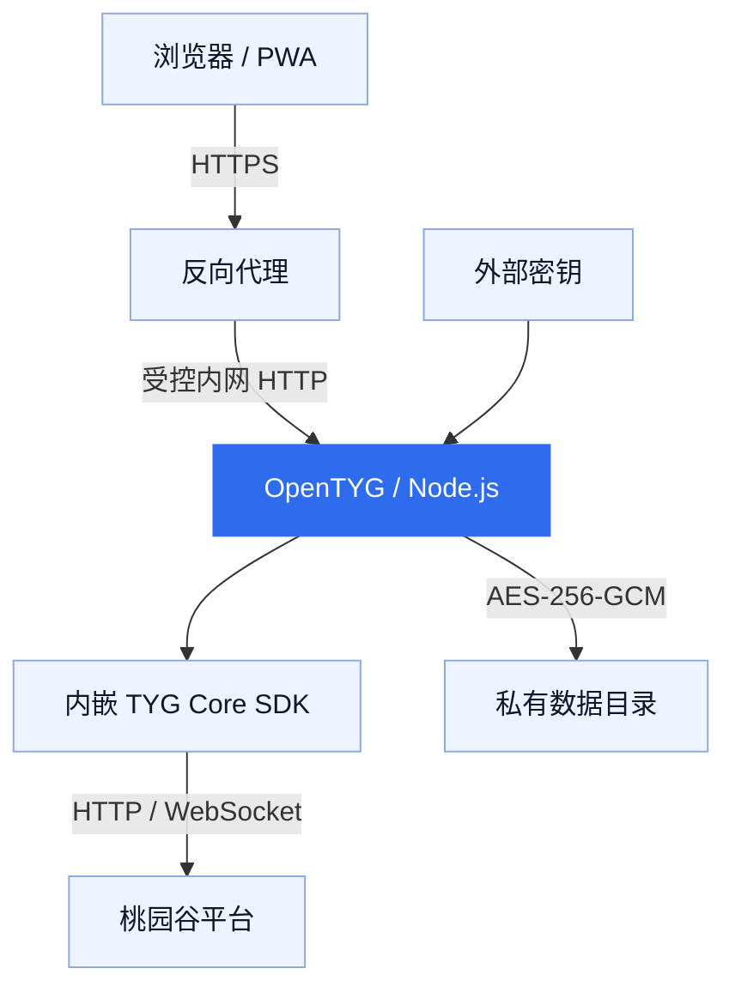

# 架构说明

[文档](README.md) / 架构 · [English](architecture.en.md)

一个 Node.js 进程提供网页和 API。浏览器只访问本站；平台登录、门禁鉴权和 WebSocket 连接均由后端完成。

## 数据流

前端为原生 HTML、CSS 和 ES modules，使用哈希路由。无需打包工具、独立数据库或 npm 运行时依赖；HTTPS 由反向代理提供。图中的上游 HTTP / WebSocket 兼容模式不具备传输加密，详见 [网络边界](security.md#网络与上线检查)。

## 代码地图

| 路径 | 职责 |
| --- | --- |
| `server/index.mjs` | 启动配置与进程关闭 |
| `server/app.mjs` | HTTP 路由、输入校验、登录与用户操作 |
| `server/service.mjs` | 账号会话池、目录加载、连接恢复与开门 |
| `server/vendor/tyg-core-sdk/src/` | 非官方平台协议适配 |
| `server/store.mjs`、`persistence.mjs` | 加密存储、原子写入与同步 |
| `server/session.mjs`、`auth-limits.mjs` | 浏览器会话与持久认证限流 |
| `server/request-security.mjs`、`frontend-policy.mjs` | Host、Origin、Cookie 与前端安全策略 |
| `server/prefs.mjs` | 按用户、房产保存收藏、排序与名称 |
| `web/js/pages/`、`web/css/` | 页面、交互与主题 |
| `web/sw.js`、`web/js/pwa.js` | 离线说明与 PWA 安装 |
| `deploy/` | 健康探针和 Nginx 示例 |

## 一次开门如何完成

完整时序与分支图见 [How it works](how-it-works.md)。以下概括源码职责。

1. 浏览器提交门 ID、房产 `householdId` 和目录 `directoryId`。
2. 后端检查会话、当前房产、目录上下文、冷却和账号串行操作约束。
3. 需要恢复连接时，重新验证房产权并定位同一个稳定门 ID。
4. 发送开门指令，等待平台回执；无法确定发送结果时返回 `OPEN_RESULT_UNKNOWN`。

门 ID 和房产 ID 来自平台稳定标识，不使用数组位置。自动恢复仅在房产及完整设备/配置指纹不变时保留 UI 目录上下文；显式 `refresh=1` 会生成新上下文。已移除的门不会被其他设备替代。

**重试止于发送边界。** 准备及可确认未发送的失败，在约 2.9 秒的共同预算内最多尝试 3 次；单阶段默认无响应时限约 950ms。指令一旦可能发送，保留单次 5 秒回执窗口，不自动重发。这些是超时配置，不是成功时延承诺。

前端在启动与回到前台时合并预热请求。热点击可直接提交开门；目录过期且服务端明确拒绝时，可刷新目录后继续原点击。API 调用方应按 [错误约定](api.md#错误处理) 处理上下文变化。

## 会话与存储

- 一个账号在进程内共享一个上游会话，账号操作串行。退出会撤销该账号在本服务的所有浏览器会话，保留偏好。
- 健康目录和房产权校验最长复用约 60 秒；WebSocket 闲置 30 分钟后释放。
- 登录及服务配置最多保留约 24 小时闲置状态、200 个账号，可能提前按 LRU 回收。缓存不延长浏览器会话权限。
- 文件存储没有跨进程锁。一个数据目录只能由一个实例写入；手动替换数据文件后应重启服务。

首页可以先展示当前 Cookie 所属用户的旧收藏视图；显示缓存不构成开门权限。记住登录、主凭据到期和房产临时凭据刷新见 [凭据生命周期](security.md#凭据生命周期)。

## PWA 与 SDK 边界

Service Worker 仅缓存公开离线说明及少量配套资源。主界面、API、验证码、账号与开门命令不进入离线缓存；命令不排队、不重放。

内嵌 SDK 是非官方协议实现，与 [独立 SDK 分支](https://github.com/zjmdong/OpenTYG/tree/opentyg-sdk) 存在部署适配差异。对讲模块是内部依赖，网页不开放对讲功能。账号校验、房产权、门禁权限和设备状态仍由平台决定。
