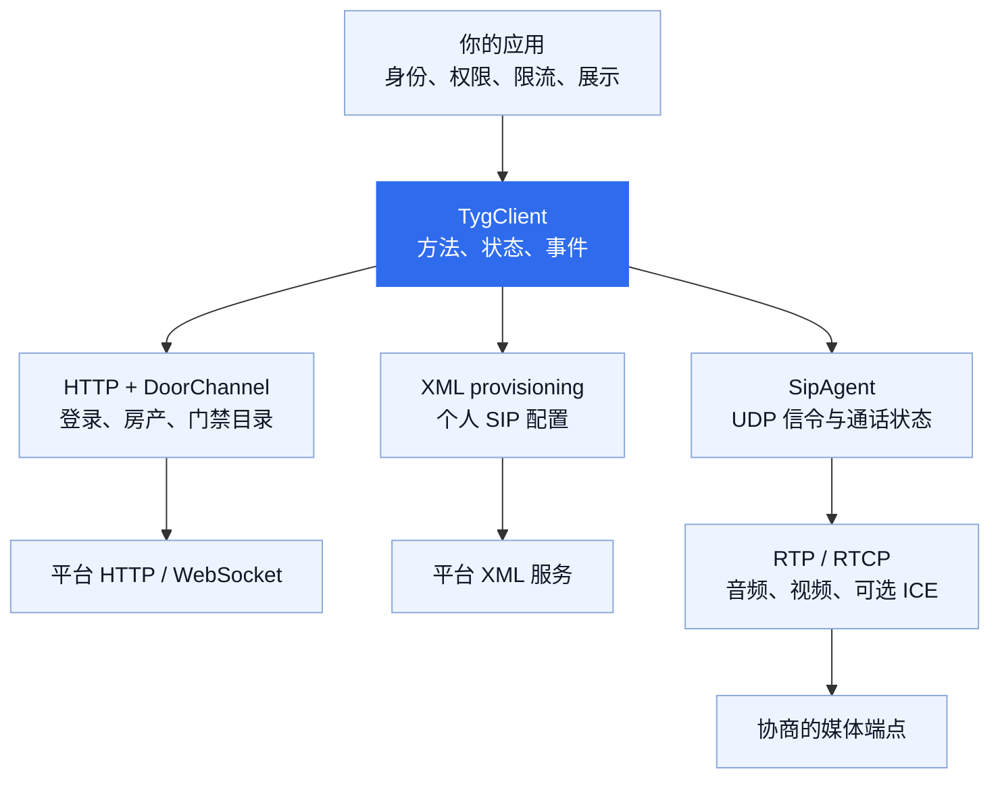

# 架构说明

[文档](README.md) / 架构 · [English](architecture.en.md)

SDK 是可信 Node.js 进程中的协议库，不启动 HTTP 服务器。一个 `TygClient` 对应一个账号，应用负责把用户、实例与当前配置关联起来。

## 模块与外部服务

门禁与对讲共享账号入口，但协议、凭据和生命周期独立。HTTP 登录成功不等于 SIP 注册完成，SIP 接听也不等于已有可播放的音视频。

## 源码地图

| 文件 | 职责 |
| --- | --- |
| [src/tyg-client.mjs](../src/tyg-client.mjs) | 服务发现、登录、房产、DoorChannel、业务互斥与对讲入口 |
| [src/tyg-client.d.ts](../src/tyg-client.d.ts) | 方法签名、目录、状态、错误及媒体事件类型 |
| [src/intercom/provision.mjs](../src/intercom/provision.mjs) | XML 鉴权、Cookie、个人配置及 PHONE_BOOK 解析 |
| [src/intercom/sip.mjs](../src/intercom/sip.mjs) | REGISTER、Digest、INVITE、CANCEL/BYE 与对话状态 |
| [src/intercom/media.mjs](../src/intercom/media.mjs) | SDP、G.711、H.264 接收、RTP/RTCP 与媒体事件 |
| [src/intercom/ice.mjs](../src/intercom/ice.mjs)、[vendor/ice/wrapper.mjs](../vendor/ice/wrapper.mjs) | 可选 ICE 与锁定的 werift-ice 依赖 |
| [src/intercom/network.mjs](../src/intercom/network.mjs) | SIP 代理解析、本地路由和 Fake-IP 回退 |
| [src/login-store.mjs](../src/login-store.mjs) | 可选 Windows 当前用户 DPAPI 存储 |

## 状态、并发与身份

- `initialize()` 发现服务；`getState()` 只读取内存快照，不续期或重新登录。
- 核心业务方法使用实例级互斥，冲突返回 `BUSY`。一个门禁通道只等待一个业务响应，避免缺少通用 requestId 时串错回执。
- `getHouseholds()` 会清空当前门连接和目录；`getDoors()` 生成新 `directoryId`。
- `household-1`、`door-1` 是当前列表引用。重新加载后须让用户依据新配置选择，不能把旧序号映射到新设备。
- `callIntercom()` 立即返回启动状态，后台通过事件推进；一个实例仅支持一个并发出呼。挂断不受呼叫后台任务阻塞。

[How it works](how-it-works.md) 展示这些约束如何影响开门、呼叫和恢复。

## 传输与秘密

| 通道 | 凭据或数据 | 集成责任 |
| --- | --- | --- |
| HTTP 登录与房产 | 密码、验证码、sessionToken、householdToken | 限制目标、验证证书、保护响应 |
| 门禁 WebSocket | URL 中的 householdToken、消息中的 authcode | 不记录凭据 URL，不重放已发送指令 |
| XML / SIP | XML Cookie、账户密码摘要、个人 SIP 密码 | 可信配置、授权设备、信令状态核对 |
| RTP / RTCP / ICE | 音视频、候选与 ICE/TURN 凭据 | 用户授权、协商端点限制、媒体可达性 |
| 序列化登录 | 登录令牌、设备身份、可能的账户密码 | 持久化前加密，独立管理密钥与保留期限 |

`fetchImpl` 仅控制 HTTP，不覆盖原生 WebSocket、DNS 和 UDP。默认 HTTP/WS 与 SIP/RTP UDP 不提供全链路加密。DPAPI 只适用 Windows 当前用户，不是跨平台存储方案。详见 [安全与集成](security.md)。

## 和 main 分支的区别

| 项目 | 独立 SDK | main 网页应用 |
| --- | --- | --- |
| 运行形态 | Node.js 库，无公网 API | 单进程网页与 API 服务 |
| 门引用 | 当前列表的临时引用 | 平台稳定标识派生的门 ID |
| 会话与存储 | 应用负责；提供序列化和可选 DPAPI | 浏览器会话、加密文件与到期清理 |
| 连接恢复 | 调用方安排重新获取目录 | 受限预算内自动准备，明确发送边界 |
| 对讲 | XML / SIP / 媒体接口 | 网页不开放对讲 |

独立核心源码的 SHA-256 见 [source-manifest.json](source-manifest.json)。不要直接用本分支覆盖 main 的 vendor 目录。
