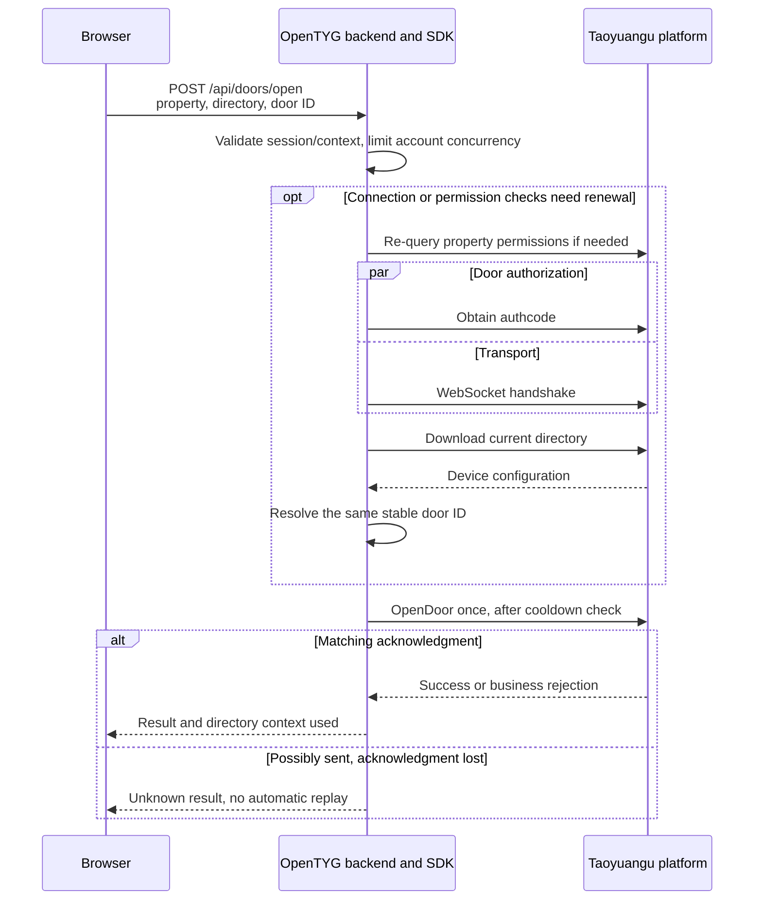
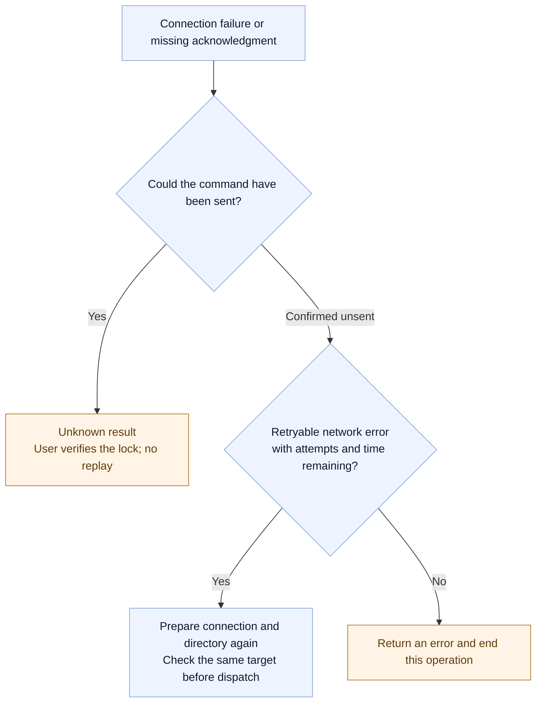
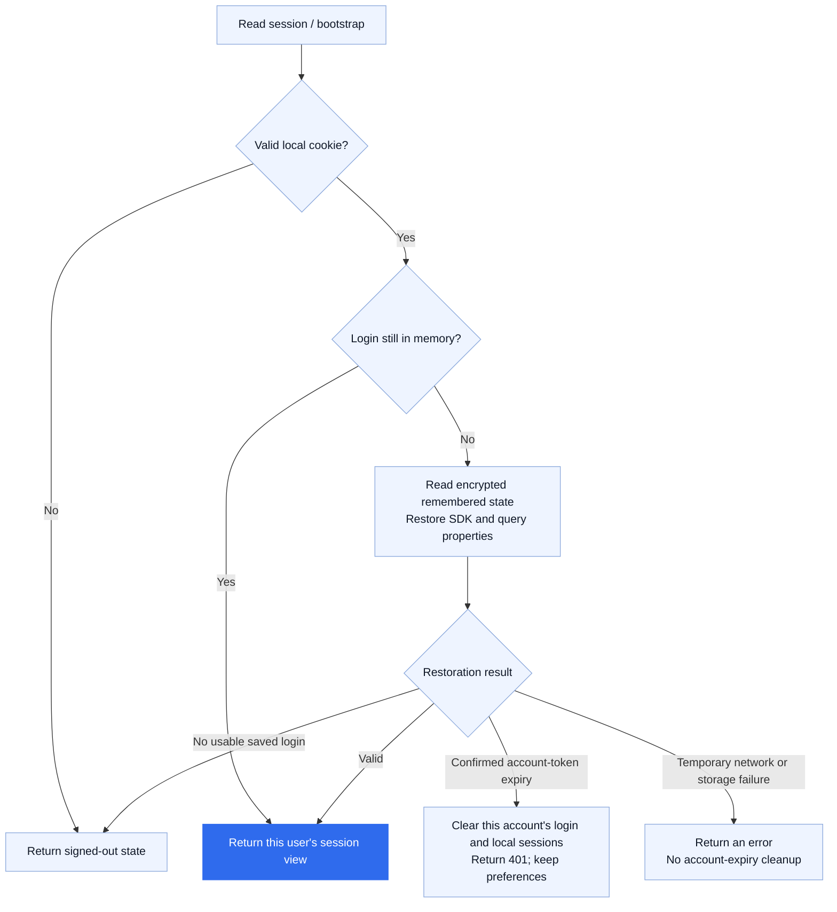

# How it works

[Docs](README.en.md) / How it works · [简体中文](how-it-works.md)

This page follows the current web app. See [Architecture](architecture.en.md) for modules and storage, and [Backend API](api.en.md) for fields and errors.

## One tap, from browser to platform

Preparation errors, revoked permissions, and removed doors stop the operation before dispatch. The acknowledgment window defaults to five seconds. Platform success does not prove that the physical lock opened.

### Three IDs, three jobs

| Field | Role |
| --- | --- |
| `householdId` | The selected authorized property |
| `directoryId` | UI directory snapshot, preventing stale actions against changed configuration |
| `doorId` | Derived from stable platform identifiers, not list position |

Automatic reconnect preserves the UI directory ID only if the property and complete device/configuration fingerprint are unchanged. The SDK connection still uses a fresh directory internally. Explicit `refresh=1` forces new context. Following an explicit `STALE_DIRECTORY` rejection, the frontend may refresh and continue the original tap only while account, property, and target remain unchanged.

## Retry preparation, not an uncertain command

- Preparation and proven pre-queue failures share approximately **2.9 seconds and at most three attempts**, with about **950ms** per unresponsive stage.
- `GET /api/doors` uses the remainder of about **three seconds measured from request start**. These are deadline settings, not latency guarantees.
- Business rejection, revoked permissions, and post-dispatch acknowledgment timeouts are not automatically retried.
- The integrated protocol has no usable idempotency key. A missing response cannot prove that the command was not applied.

## Restoring a session

In-memory login permits a session view, not unchecked door access. Later commands still validate permissions and connectivity. Explicit account-token expiry during restoration or business operations revokes that account's local sessions without affecting other accounts. Temporary property-token expiry is refreshed within the preparation deadline and is distinct from account expiry.

| Lifecycle | Current limit or behavior |
| --- | --- |
| Browser-only session | At most 12 hours; not restored after restart |
| Remembered session | At most 30 days, subject to earlier platform expiry |
| Healthy directory / property check | Reused for up to approximately 60 seconds |
| Idle WebSocket | Released after 30 minutes |
| In-memory login and service configuration | Approximately 24 idle hours, 200 accounts maximum, possible earlier LRU eviction |

Cached favorites speed up display only. Caches extend neither session authority nor platform permission. See [Privacy and operations](security.en.md) for storage boundaries.

## Read alongside the code

| Entry point | What to inspect |
| --- | --- |
| [web/js/open.js](../web/js/open.js) | User intent, stale-context refresh, unknown-result UI |
| [web/js/doorConnection.js](../web/js/doorConnection.js) | Coalesced foreground recovery and warm-up |
| [server/app.mjs](../server/app.mjs) | Sessions, directory checks, concurrency, expiry cleanup |
| [server/service.mjs](../server/service.mjs) | Preparation budgets, permission refresh, stable IDs, dispatch boundary |
| [Embedded SDK](../server/vendor/tyg-core-sdk/src/tyg-client.mjs) | Platform credentials, WebSocket messages, acknowledgments |

This describes main's adapted implementation. The standalone SDK uses temporary directory references and different persistence/restoration responsibilities; see its [How it works](https://github.com/zjmdong/OpenTYG/blob/opentyg-sdk/docs/how-it-works.en.md).
