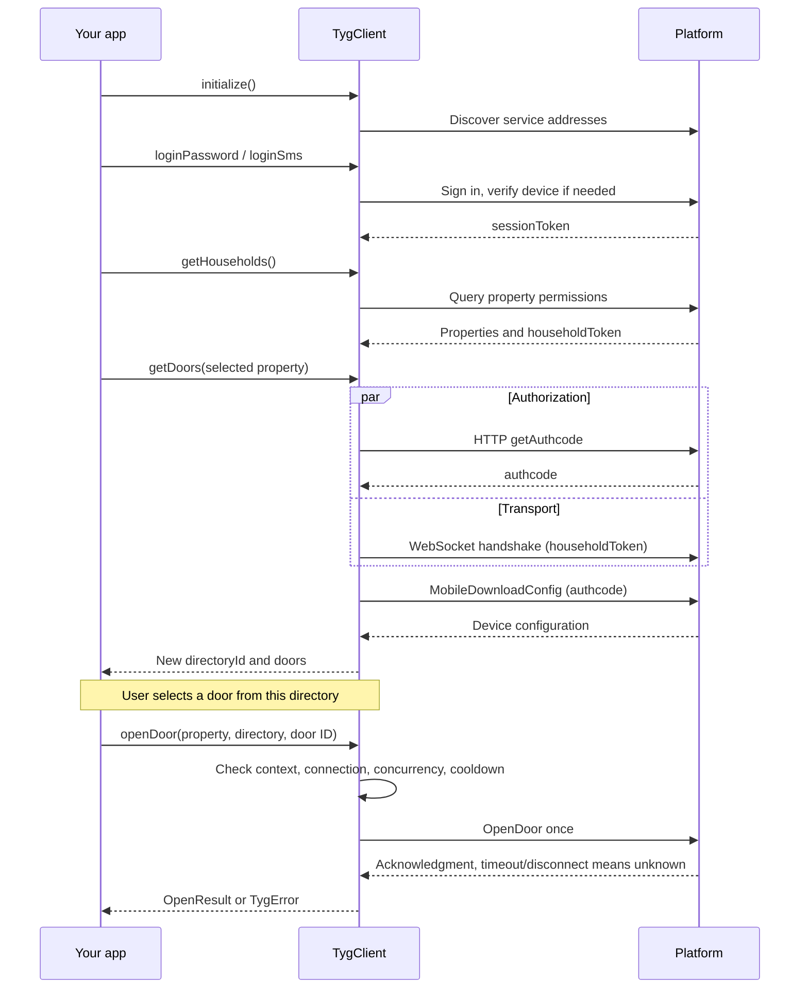
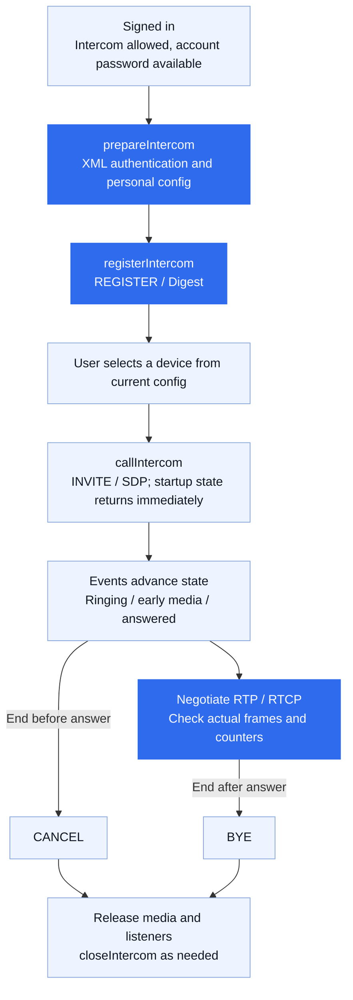
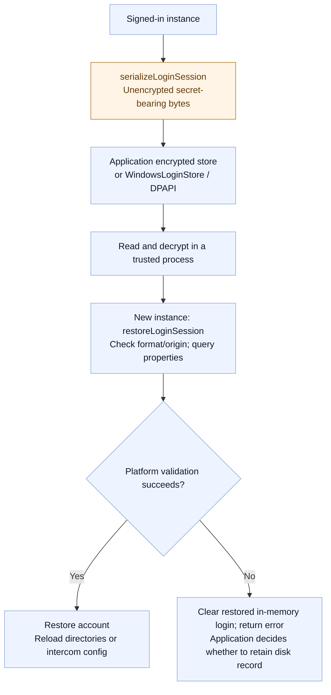

# How it works

[Docs](README.en.md) / How it works · [简体中文](how-it-works.md)

These flows describe standalone SDK v0.3.4, without main's browser sessions, stable door IDs, or automatic connection-recovery policy.

## Doors: directory first, explicit action second

`getHouseholds()` clears the previous door connection and directory. Each `getDoors()` creates a new directory. Update UI context rather than reusing the previous `door-1`.

| Credential | Source | Used for |
| --- | --- | --- |
| `sessionToken` | Successful sign-in | Property lookup and remote logout |
| `householdToken` | Current authorized property | Door HTTP authorization and WebSocket URL |
| `authcode` | Door authorization response | WebSocket business message headers |

Success codes vary: SMS sending uses `code=1`, whereas login normally uses `code=0`. Door acknowledgment requires `result=0`, `code=0`, and `data="开门成功"`. Even then, `physicalStateVerified` is `false`. See the [platform reference](platform-api.md).

### After a failure

For pre-send disconnection, the application reloads the directory and obtains a new user selection. Post-send timeout or disconnection means `OPEN_RESULT_UNKNOWN`, never an automatic retry. Timed-out channels are discarded so late replies cannot match a later operation. The default acknowledgment window is five seconds, with a three-second per-instance command interval; neither is a platform guarantee or account-wide rate limit.

## Intercom: provisioning, signaling, media

This is the normal outbound path. Any stage may fail; state/events expose errors without automatically calling again.

- XML uses an account-password digest and a shared provisioning cookie. An HTTP login token cannot replace personal SIP credentials.
- `callIntercom()` defaults to `mode: 'talk'`. Monitoring requires explicit `mode: 'monitor', video: true` and carries no audio.
- `183 + SDP` can start early media without final acceptance. SIP 200/ACK does not prove media reachability.
- Audio input is **PCM16LE / 8 kHz mono / 20ms / 320 bytes**. Video events carry Annex B H.264; your app handles decoding and playback.
- ICE requires negotiation and usable candidates. No public STUN/TURN is preset. An HTTPS reverse proxy does not transport SIP/RTP UDP.

See [Intercom protocols](intercom-protocol.md) for the five XML messages, SIP fields, and media formats.

## Persistence: serialization is not encryption

Saved state excludes the current door WebSocket, authcode, selected door, and calls. Restoration failures do not delete your files. Distinguish explicit credential rejection from transient network failure. The web app's 30-day remembered-session policy does not apply here.

## Logout and cleanup

| Method | Local resources | Platform action | Reuse |
| --- | --- | --- | --- |
| `hangupIntercom()` | Ends media/current call | CANCEL or BYE; acknowledgment may be unconfirmed | Instance remains usable |
| `closeIntercom()` | Media, timers, personal configuration | Best-effort hangup/deregistration | Door login remains usable |
| `logout()` | Clears login, door, and intercom state first | Then attempts remote logout | Instance can sign in again |
| `close()` | Synchronously releases resources | No HTTP remote logout; best-effort intercom cleanup | Instance cannot be reused |

If hangup confirmation matters, `await hangupIntercom()` before removing listeners/configuration. Clean up your own sessions and storage even after remote logout fails. See the [SDK reference](sdk-reference.en.md).
