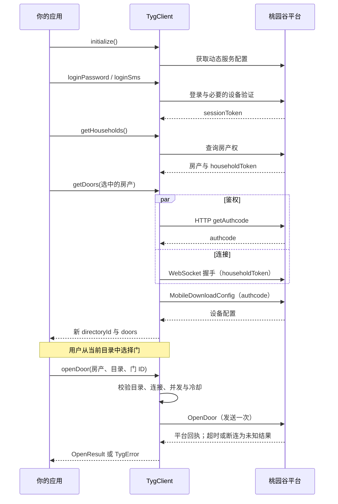
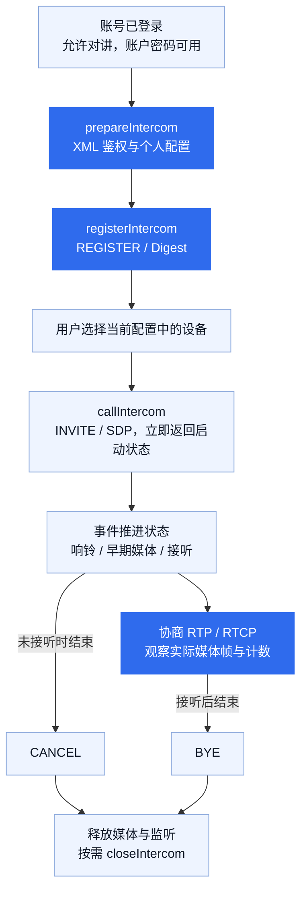
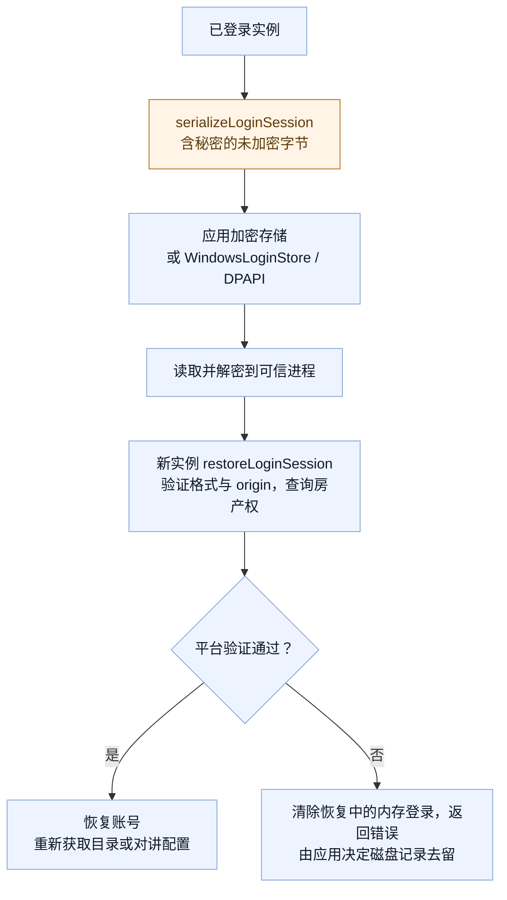

# How it works

[文档](README.md) / 工作流程 · [English](how-it-works.en.md)

以下为独立 SDK v0.3.4 的流程。它不包含 main 网页应用的会话服务、稳定门 ID 或自动连接恢复策略。

## 门禁：先目录，后操作

`getHouseholds()` 会清除旧门连接和目录；`getDoors()` 每次产生新目录。调用后必须同步界面上下文，不能继续使用上一份 `door-1`。

| 凭据 | 来源 | 仅用于 |
| --- | --- | --- |
| `sessionToken` | 登录成功 | 查询房产、平台退出 |
| `householdToken` | 当前有效房产 | 门禁 HTTP 鉴权、WebSocket URL |
| `authcode` | 门禁鉴权响应 | WebSocket 业务消息头 |

平台成功码不统一：短信发送是 `code=1`，登录通常为 `code=0`。开门确认要求 `result=0`、`code=0` 和 `data="开门成功"`；即使匹配，`physicalStateVerified` 仍是 `false`。字段以 [平台参考](platform-api.md) 为准。

### 失败之后

发送前断连时，由应用重新加载目录、让用户重新选择。发送后超时或断连是 `OPEN_RESULT_UNKNOWN`，不得自动重发；SDK 会废弃超时通道，避免迟到回执串到下次操作。默认回执等待 5 秒、实例开门间隔 3 秒，不是平台服务承诺或账号级限流。

## 对讲：配置、信令、媒体是三步

图示为正常出呼路径；任何阶段都可能失败，错误由 state/event 暴露，不自动再次呼叫。

- XML 使用账户密码摘要和同一配置会话的 Cookie；HTTP 登录 token 不能替代个人 SIP 密码。
- `callIntercom()` 默认 `mode: 'talk'`。监看须显式设置 `mode: 'monitor', video: true`，不收发音频。
- `183 + SDP` 可能产生早期媒体，不等于最终接听；SIP 200/ACK 也不能证明媒体可达。
- 音频输入是 **PCM16LE / 8 kHz 单声道 / 20ms / 320 字节**；视频事件是 Annex B H.264，解码与播放由应用完成。
- ICE 需双方协商及可用候选；SDK 不预置公共 STUN/TURN。普通 HTTPS 反代不会转发 SIP/RTP UDP。

五类 XML 消息、SIP 字段与媒体格式见 [对讲协议](intercom-protocol.md)。

## 保存与恢复：序列化不是加密

保存内容不包含当前门 WebSocket、authcode、选门或通话。恢复失败不自动删除你的文件；应用须区分明确凭据拒绝与暂时网络错误。这里没有网页端“记住 30 天”的会话政策。

## 退出与释放

| 方法 | 本地资源 | 平台操作 | 后续使用 |
| --- | --- | --- | --- |
| `hangupIntercom()` | 结束媒体与当前呼叫 | CANCEL 或 BYE；结果可能未确认 | 可继续使用实例 |
| `closeIntercom()` | 清理媒体、计时器、个人配置 | 尽力挂断/注销 | 门禁登录仍可用 |
| `logout()` | 先清理登录、门禁和对讲状态 | 再尝试平台退出 | 实例可重新登录 |
| `close()` | 同步释放实例资源 | 不调用 HTTP 平台退出；对讲尽力清理 | 实例不可复用 |

需确认挂断时，先 `await hangupIntercom()`，再释放监听与配置。远程退出失败也应清理应用自己的会话和存储。调用细节见 [SDK 参考](sdk-reference.md)。
