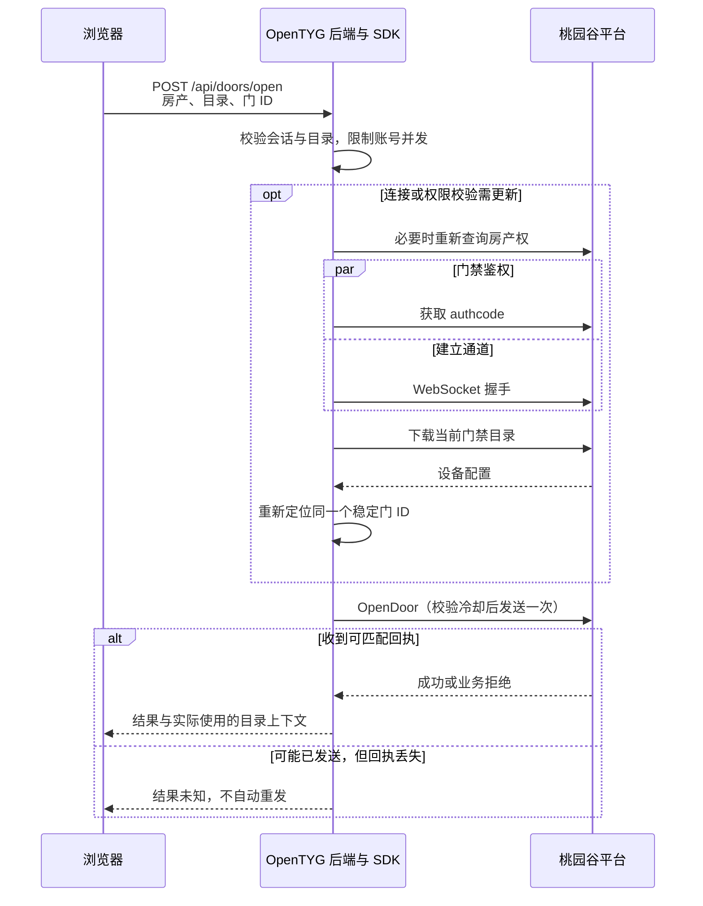
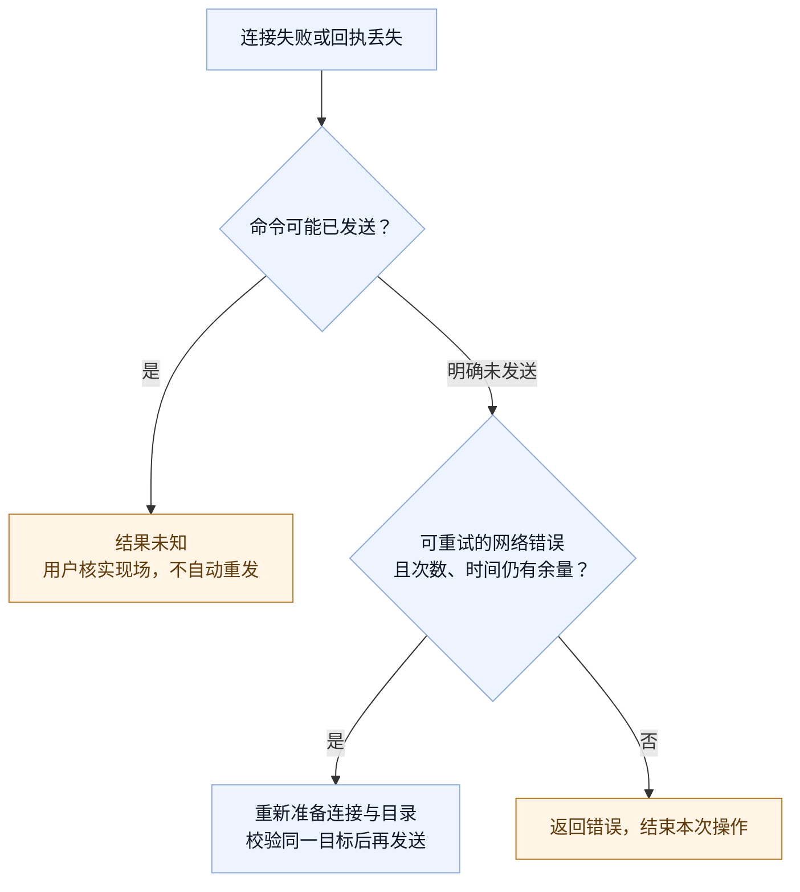
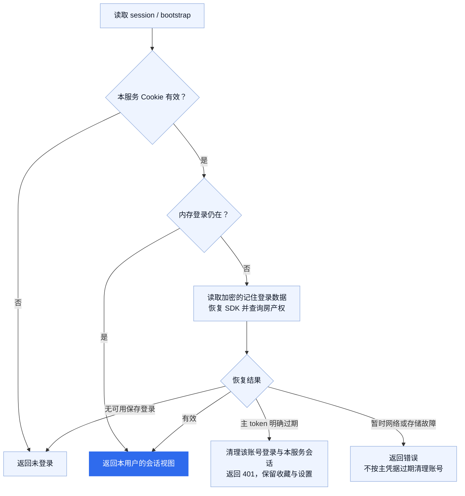

# How it works

[文档](README.md) / 工作流程 · [English](how-it-works.en.md)

本页解释当前网页应用的运行流程。模块与存储位置见 [架构说明](architecture.md)，字段与错误码见 [后端 API](api.md)。

## 一次点按，从页面到平台

准备失败、权限失效或门被移除时，流程在发送前结束。正常回执等待默认 5 秒；平台成功回执不证明物理门锁一定开启。

### 三个 ID，各管什么

| 字段 | 作用 |
| --- | --- |
| `householdId` | 当前选中的授权房产 |
| `directoryId` | UI 使用的目录快照，防止旧操作落到新目录 |
| `doorId` | 从平台稳定标识派生的门 ID，不使用列表位置 |

自动重连仅在房产及完整设备/配置指纹不变时保留 UI 目录 ID；SDK 内部连接仍使用新目录。显式 `refresh=1` 强制新上下文。前端收到明确的 `STALE_DIRECTORY` 拒绝后，可在账号、房产与目标门不变的条件下刷新并继续原点击。

## 为什么连接可重试，开门不能盲目重发

- 准备和明确未入队的失败共享约 **2.9 秒、最多 3 次尝试**的预算；单阶段无响应时限约 **950ms**。
- `GET /api/doors` 使用从请求开始计算的约 **3 秒剩余预算**。这些是配置时限，不是成功时延保证。
- 业务拒绝、权限撤销和已发送后的回执超时不进入自动重试。
- 协议没有供本实现使用的幂等请求编号；“没收到响应”不能推导成“没开门”。

## 登录恢复与失效

“内存登录仍在”只表示可恢复会话视图，后续门禁操作仍检查权限与连接。房产权查询明确报告主 token 过期时，无论在恢复还是业务操作中，都撤销该账号的本服务会话；其他账号不受影响。房产临时 token 失效则在准备时限内刷新，不等同于主登录过期。

| 生命周期 | 当前值或行为 |
| --- | --- |
| 普通浏览器会话 | 最长 12 小时，重启不恢复 |
| 记住登录 | 最长 30 天绝对期限，平台可提前失效 |
| 健康目录 / 房产权校验 | 最长复用约 60 秒 |
| 闲置 WebSocket | 30 分钟后释放 |
| 内存登录与服务配置 | 约 24 小时闲置、最多 200 个账号，可提前 LRU 回收 |

旧收藏视图仅用于更快展示；缓存不延长会话有效期，也不代替平台授权。完整存储边界见 [隐私与运维](security.md)。

## 对照源码阅读

| 入口 | 关注点 |
| --- | --- |
| [web/js/open.js](../web/js/open.js) | 用户意图、过期目录刷新、结果未知提示 |
| [web/js/doorConnection.js](../web/js/doorConnection.js) | 合并前台恢复与预热 |
| [server/app.mjs](../server/app.mjs) | 会话与目录校验、账号并发、过期清理 |
| [server/service.mjs](../server/service.mjs) | 准备预算、权限刷新、稳定门 ID、发送边界 |
| [内嵌 SDK](../server/vendor/tyg-core-sdk/src/tyg-client.mjs) | 平台凭据、WebSocket 消息与回执 |

这里描述的是 main 的适配实现。独立 SDK 的临时目录引用、保存和恢复策略不同，见 [SDK 工作流程](https://github.com/zjmdong/OpenTYG/blob/opentyg-sdk/docs/how-it-works.md)。
