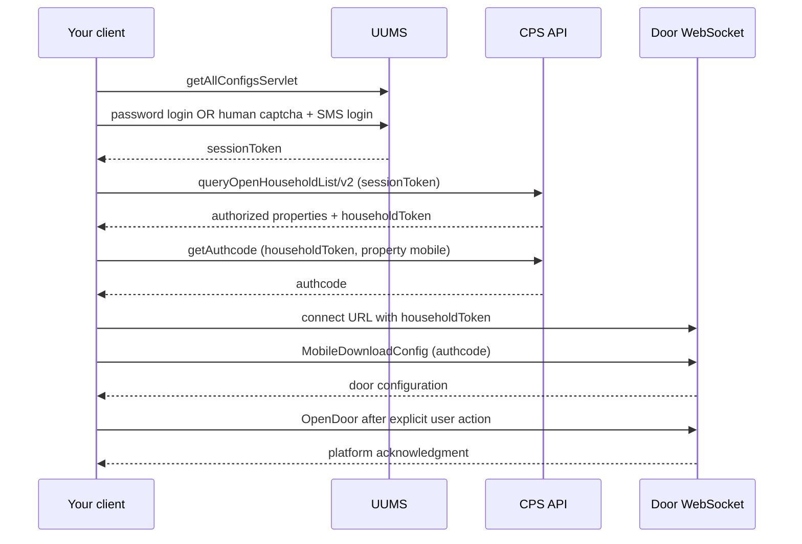

# 桃园谷平台 HTTP 与 WebSocket API / Platform API reference

[中文 README](../README.md) · [English README](../README.en.md) · [OpenAPI 3.1](platform-openapi.json) · [对讲协议](intercom-protocol.md)

**非官方整理文档。** 描述桃园谷平台实际使用的协议，依据公开客户端资料与 SDK v0.3.4 实现整理，客户端分析基线为 Android 1.3.8；不是桃园谷官方发布的开发者文档，也没有平台稳定性保证。字段、地址和服务行为应以合法授权环境的实际返回为准。此处不描述 OpenTYG 或原本地原型服务器的 API。请先阅读 [免责声明](../DISCLAIMER.md)。全部示例为占位值，不含真实凭据。

**English:** This independently maintained reference documents platform wire protocols, not OpenTYG backend routes. It is based on SDK v0.3.4 and public-client protocol analysis (Android 1.3.8), is not official developer documentation, and carries no platform stability guarantee. Examples are placeholders. The HTTP OpenAPI file describes only JSON POST operations; WebSocket and XML/SIP/RTP are separate protocols.

## 1. 服务入口 / Service discovery

初始入口由 SDK 的 `DEFAULT_ORIGIN` 给出：`http://lxj.taoyuangu.com:80`。这是实现中的兼容默认值，不是对该地址当前在线或可用的保证。先调用配置接口，读取 `serverConfigs`：

| 键 | 用途 |
| --- | --- |
| `uums_server` | 验证码、短信、登录、退出 |
| `cpsApi_server` | 房产列表、门禁 authcode |
| `htmlvdcs_server` | 门禁 WebSocket 地址基准 |
| `outerTalkbackSystemUrl` | 对讲 XML 入口，见对讲协议 |

返回值是动态 URL，不应硬编码其他服务主机。HTTP 路径以 `/` 开头，使用 `new URL(path, returnedBase)` 从主机根路径解析；不要重复拼接 `/uums` 或 `/cpsApi`。缺少前三个键时，SDK 回退到 `<origin>/<service>/`。集成方应限制允许访问的主机和协议，拒绝地址中的用户名/密码及不可信重定向；上游配置不是自动可信的 SSRF 白名单。

默认兼容 HTTP/WS。它们传输的密码和令牌可能为明文；你自己的网站使用 HTTPS 不会加密服务器到上游这一段。不得为了连接而关闭证书校验。仅在平台确认支持并验证兼容后使用 HTTPS/WSS。

## 2. JSON 请求信封 / Request envelope

全部下述 HTTP 路径使用 `POST`，`Content-Type: application/json; charset=UTF-8`，`Accept: application/json`。

```json
{
  "header": {
    "time_stamp": "20261012120000",
    "token": "<TOKEN_FOR_THIS_OPERATION>"
  },
  "body": {}
}
```

`time_stamp` 为 `yyyyMMddHHmmss`，本实现默认 `Asia/Shanghai`。初始化、验证码、短信、登录使用每次请求生成的 prelogin 摘要：

```text
ms = Unix 时间戳毫秒（十进制字符串）
prelogin = MD5_UPPER("EA3vWPmfxhWUit2s" + ms)
```

该字符串是客户端协议兼容常量，**不是账号秘密、私钥或权限凭据**。prelogin 摘要不代表登录，不授予房产或门禁权限。`time_stamp` 与摘要应基于同一次请求时刻。后续请求使用各自的服务端令牌。不要把 HTTP `header.token` 误写成 HTTP `Authorization` 请求头。

| 凭据 | 来源 | 用途 |
| --- | --- | --- |
| `sessionToken` | 登录成功响应 `token` | 房产列表、平台退出 |
| `householdToken` | 选中房产的 `token` | 门禁鉴权 HTTP、WS URL 查询参数 |
| `authcode` | 门禁鉴权响应 `data.data` | WS 消息 `header.token` |

Three credentials have distinct roles: login token for property listing/logout; selected-property token for door authorization and the WebSocket URL; door authcode for WebSocket messages. They are not interchangeable. Lifetimes are not defined by this reference; revalidate against the platform rather than assuming a fixed TTL.

## 3. 调用顺序 / Request sequence



登录两种方式任选其一。验证码由用户人工填写；不要自动识别或批量发送短信。房产中只有 `valid=1` 的条目可继续门禁操作，房产 `mobile` 可能与登录时输入号码不同，应使用该房产返回值。

## 4. HTTP 路径总览 / Endpoint index

| 操作 | 路径（全部 POST） | `header.token` |
| --- | --- | --- |
| [下载服务配置](#initialize) | `/uums/servlet/getAllConfigsServlet` | prelogin 摘要 |
| [获取图形挑战 seed](#captchaseed) | `/uums/servlet/getAuthcodeServlet` | prelogin 摘要 |
| [取得图形验证码图片 URL](#captcha) | `/uums/servlet/getAuthPicRandomServlet` | prelogin 摘要 |
| [刷新图形验证码](#captcharefresh) | `/uums/servlet/getPicRandomServlet` | prelogin 摘要 |
| [请求登录 / 设备验证短信](#sms) | `/uums/servlet/getRandomCodeForSmsLogin` | prelogin 摘要 |
| [手机号短信登录](#loginsms) | `/uums/servlet/smsUserLogin` | prelogin 摘要 |
| [账户密码登录](#loginpassword) | `/uums/servlet/userLoginServlet` | prelogin 摘要 |
| [查询房产开门权限](#households) | `/cpsApi/servlet/queryOpenHouseholdList/v2` | sessionToken |
| [获取门禁 authcode](#doorauth) | `/cpsApi/openDoor/getAuthcode` | householdToken |
| [原服务退出登录](#logout) | `/uums/servlet/userLogout` | sessionToken |

## 5. HTTP 字段与回执 / HTTP requests and responses

下表 body 字段在请求信封的 `body` 中。响应示例为平台原始 JSON，并非 SDK 归一化返回类型。字段表中的必需指成功路径消费要求；平台失败响应可以省略成功字段。未知字段应保留兼容，不能假设响应只包含所列内容。

<a id="initialize"></a>

### 下载服务配置 / `initialize`

`POST /uums/servlet/getAllConfigsServlet`

服务：`初始 origin`。凭据：**prelogin 摘要**。

**body 字段：**

空对象 `{}`。

**请求 body 示例：**

```json
{}
```

**平台响应字段：**

| 字段 / Field | 类型 / Type | 必需 / Required | 说明 / Description |
| --- | --- | --- | --- |
| `result` | string | 是 / yes | 0 为成功。 |
| `serverConfigs` | array | 是 / yes | 动态服务地址。 |
| `serverConfigs[].key` | string | 是 / yes | 服务键，当前使用 uums_server/cpsApi_server/htmlvdcs_server。 |
| `serverConfigs[].value` | string | 是 / yes | 服务 base URL。 |

**成功响应示例：**

```json
{
  "result": "0",
  "serverConfigs": [
    {
      "key": "uums_server",
      "value": "<RETURNED_UUMS_BASE_URL>"
    },
    {
      "key": "cpsApi_server",
      "value": "<RETURNED_CPS_BASE_URL>"
    },
    {
      "key": "htmlvdcs_server",
      "value": "<RETURNED_DOOR_BASE_URL>"
    }
  ]
}
```

**成功判定：** result=0 且 serverConfigs 是数组；保留当前模块需要的三类地址。

- 使用原初始入口；后续 HTTP 路径是绝对路径，避免重复拼接 /uums 或 /cpsApi。

<a id="captchaseed"></a>

### 获取图形挑战 seed / `captchaSeed`

`POST /uums/servlet/getAuthcodeServlet`

服务：`uums_server`。凭据：**prelogin 摘要**。

**body 字段：**

| 字段 / Field | 类型 / Type | 必需 / Required | 说明 / Description |
| --- | --- | --- | --- |
| `phone` | string | 是 / yes | 由用户提供的已授权手机号；示例为占位值。 |

**请求 body 示例：**

```json
{
  "phone": "<PHONE>"
}
```

**平台响应字段：**

| 字段 / Field | 类型 / Type | 必需 / Required | 说明 / Description |
| --- | --- | --- | --- |
| `result` | string | 是 / yes | 0 为成功。 |
| `authCode` | string | 是 / yes | 图形挑战 seed。 |

**成功响应示例：**

```json
{
  "result": "0",
  "authCode": "CAPTCHA_SEED"
}
```

**成功判定：** result=0，authCode 非空。

- authCode 是图形挑战 seed，不是门禁 authcode。首次获取图片必须先执行此步骤。

<a id="captcha"></a>

### 取得图形验证码图片 URL / `captcha`

`POST /uums/servlet/getAuthPicRandomServlet`

服务：`uums_server`。凭据：**prelogin 摘要**。

**body 字段：**

| 字段 / Field | 类型 / Type | 必需 / Required | 说明 / Description |
| --- | --- | --- | --- |
| `phone` | string | 是 / yes | 由用户提供的已授权手机号；示例为占位值。 |
| `authCode` | string | 是 / yes | MD5(MD5("LXJ_SJM") + "_" + seed.authCode)，两次均为大写 MD5。 |

**请求 body 示例：**

```json
{
  "phone": "<PHONE>",
  "authCode": "<DOUBLE_MD5_CAPTCHA_AUTH>"
}
```

**平台响应字段：**

| 字段 / Field | 类型 / Type | 必需 / Required | 说明 / Description |
| --- | --- | --- | --- |
| `result` | string | 是 / yes | 0 为成功。 |
| `picRandomUrl` | string | 是 / yes | 验证码图片 URL，可能为绝对或相对地址。 |

**成功响应示例：**

```json
{
  "result": "0",
  "picRandomUrl": "<服务端返回的图片 URL>"
}
```

**成功判定：** result=0，picRandomUrl 非空且为 HTTP/HTTPS URL。

- 获得 URL 后再 GET 图片，不能把 JSON 响应直接当图片使用。

<a id="captcharefresh"></a>

### 刷新图形验证码 / `captchaRefresh`

`POST /uums/servlet/getPicRandomServlet`

服务：`uums_server`。凭据：**prelogin 摘要**。

**body 字段：**

| 字段 / Field | 类型 / Type | 必需 / Required | 说明 / Description |
| --- | --- | --- | --- |
| `phone` | string | 是 / yes | 由用户提供的已授权手机号；示例为占位值。 |

**请求 body 示例：**

```json
{
  "phone": "<PHONE>"
}
```

**平台响应字段：**

| 字段 / Field | 类型 / Type | 必需 / Required | 说明 / Description |
| --- | --- | --- | --- |
| `result` | string | 是 / yes | 0 为成功。 |
| `picRandomUrl` | string | 是 / yes | 新的验证码图片 URL。 |

**成功响应示例：**

```json
{
  "result": "0",
  "picRandomUrl": "<新的图片 URL>"
}
```

**成功判定：** result=0，picRandomUrl 非空。

- 此平台刷新路径只传 phone，不复用首次 authCode 摘要。

<a id="sms"></a>

### 请求登录 / 设备验证短信 / `sms`

`POST /uums/servlet/getRandomCodeForSmsLogin`

服务：`uums_server`。凭据：**prelogin 摘要**。

**body 字段：**

| 字段 / Field | 类型 / Type | 必需 / Required | 说明 / Description |
| --- | --- | --- | --- |
| `phone` | string | 是 / yes | 由用户提供的已授权手机号；示例为占位值。 |
| `picRandom` | string | 是 / yes | 用户人工填写的图形字符。 |
| `sourceClientCode` | string | 是 / yes | 来源客户端。 固定值：`tyg_u`。 |

**请求 body 示例：**

```json
{
  "phone": "<PHONE>",
  "picRandom": "<人工填写的图形码>",
  "sourceClientCode": "tyg_u"
}
```

**平台响应字段：**

| 字段 / Field | 类型 / Type | 必需 / Required | 说明 / Description |
| --- | --- | --- | --- |
| `result` | string | 是 / yes | 0 表示请求结果成功。 |
| `code` | string | 是 / yes | 1 才表示短信已发送。 |
| `reason` | string | 条件 / optional | 失败说明；可选。 |

**成功响应示例：**

```json
{
  "result": "0",
  "code": "1"
}
```

**成功判定：** result=0 且 code=1。

- code=2 图形码错误；-1 获取过于频繁；3 当日次数超限；其他状态按 reason 显示。

<a id="loginsms"></a>

### 手机号短信登录 / `loginSms`

`POST /uums/servlet/smsUserLogin`

服务：`uums_server`。凭据：**prelogin 摘要**。

**body 字段：**

| 字段 / Field | 类型 / Type | 必需 / Required | 说明 / Description |
| --- | --- | --- | --- |
| `mobile` | string | 是 / yes | 由用户提供的已授权手机号；示例为占位值。 |
| `smsVerifyCode` | string | 是 / yes | 用户收到的短信码。 |
| `clientCode` | string | 是 / yes | 原 APP 客户端标识。 固定值：`tyg_u`。 |
| `lastLoginOs` | string | 是 / yes | 设备类型：小米 2、华为 3、通用 Android 4、荣耀 5。 可选：`['2', '3', '4', '5']`。 默认：`4`。 |
| `changeDeviceValidate` | string | 是 / yes | 保留原 APP 的设备变更验证开关。 固定值：`1`。 |
| `lastLoginDeviceToken` | string | 是 / yes | 官方设备推送 token；当前SDK默认空字符串。 默认：``。 |
| `deviceUniqueId` | string | 是 / yes | OAID / 官方设备标识；当前SDK默认空字符串。 默认：``。 |

**请求 body 示例：**

```json
{
  "clientCode": "tyg_u",
  "lastLoginOs": "4",
  "changeDeviceValidate": "1",
  "lastLoginDeviceToken": "",
  "deviceUniqueId": "",
  "mobile": "<PHONE>",
  "smsVerifyCode": "<收到的短信码>"
}
```

**平台响应字段：**

| 字段 / Field | 类型 / Type | 必需 / Required | 说明 / Description |
| --- | --- | --- | --- |
| `result` | string | 是 / yes | 0 为成功。 |
| `code` | string | 是 / yes | 0 为登录成功。 |
| `token` | string | 是 / yes | 登录 sessionToken。 |
| `userAccount` | string | 条件 / optional | 原服务账号标识，SDK 缺失时归一为 ""。 |
| `name` | string | 条件 / optional | 用户名称，SDK 缺失时归一为 ""。 |
| `password` | string | 条件 / optional | 可选：平台返回的 Base64 账户密码，对讲鉴权使用；Base64 不是加密，严禁记录真实值。 |
| `talkForbidStatus` | integer / string | 条件 / optional | 可选：值 1 表示账号对讲被禁用；不得绕过。 |

**成功响应示例：**

```json
{
  "result": "0",
  "code": "0",
  "token": "<SESSION_TOKEN>",
  "userAccount": "USER_ACCOUNT",
  "name": "演示用户"
}
```

**成功判定：** result=0、code=0、token 非空；code=2 表示短信验证码错误。

- 后续房产查询和远程退出使用此登录 token。
- 响应可能包含 Base64 的 password 和 talkForbidStatus。独立 SDK 可在内存中保留账户密码供对讲使用；不要将完整登录响应转发到浏览器。

<a id="loginpassword"></a>

### 账户密码登录 / `loginPassword`

`POST /uums/servlet/userLoginServlet`

服务：`uums_server`。凭据：**prelogin 摘要**。

**body 字段：**

| 字段 / Field | 类型 / Type | 必需 / Required | 说明 / Description |
| --- | --- | --- | --- |
| `account` | string | 是 / yes | 账号或手机号。 |
| `password` | string | 是 / yes | 原账户密码，不做本地 MD5 转换。 |
| `changeDeviceSmsCode` | string | 是 / yes | 服务要求设备变更验证时提供，否则传空字符串。 默认：``。 |
| `clientCode` | string | 是 / yes | 原 APP 客户端标识。 固定值：`tyg_u`。 |
| `lastLoginOs` | string | 是 / yes | 设备类型：小米 2、华为 3、通用 Android 4、荣耀 5。 可选：`['2', '3', '4', '5']`。 默认：`4`。 |
| `changeDeviceValidate` | string | 是 / yes | 保留原 APP 的设备变更验证开关。 固定值：`1`。 |
| `lastLoginDeviceToken` | string | 是 / yes | 官方设备推送 token；当前SDK默认空字符串。 默认：``。 |
| `deviceUniqueId` | string | 是 / yes | OAID / 官方设备标识；当前SDK默认空字符串。 默认：``。 |

**请求 body 示例：**

```json
{
  "clientCode": "tyg_u",
  "lastLoginOs": "4",
  "changeDeviceValidate": "1",
  "lastLoginDeviceToken": "",
  "deviceUniqueId": "",
  "account": "<账号>",
  "password": "<用户输入的密码>",
  "changeDeviceSmsCode": ""
}
```

**平台响应字段：**

| 字段 / Field | 类型 / Type | 必需 / Required | 说明 / Description |
| --- | --- | --- | --- |
| `result` | string | 是 / yes | 0 为成功。 |
| `code` | string | 是 / yes | 0 成功，3 要求设备变更验证，4 设备验证失败。 |
| `token` | string | 是 / yes | 登录 sessionToken。 |
| `userAccount` | string | 条件 / optional | 原服务账号标识。 |
| `name` | string | 条件 / optional | 名称。 |
| `password` | string | 条件 / optional | 可选：平台返回的 Base64 账户密码，对讲鉴权使用；Base64 不是加密，严禁记录真实值。 |
| `talkForbidStatus` | integer / string | 条件 / optional | 可选：值 1 表示账号对讲被禁用；不得绕过。 |

**成功响应示例：**

```json
{
  "result": "0",
  "code": "0",
  "token": "<SESSION_TOKEN>",
  "userAccount": "USER_ACCOUNT",
  "name": "演示用户"
}
```

**成功判定：** result=0、code=0、token 非空。

- code=3 要求设备变更验证；获取短信并传 changeDeviceSmsCode 再登录。code=4 表示设备验证失败。
- 响应可能包含 Base64 的 password 和 talkForbidStatus。独立 SDK 可在内存中保留账户密码供对讲使用；不要将完整登录响应转发到浏览器。

<a id="households"></a>

### 查询房产开门权限 / `households`

`POST /cpsApi/servlet/queryOpenHouseholdList/v2`

服务：`cpsApi_server`。凭据：**sessionToken**。

**body 字段：**

| 字段 / Field | 类型 / Type | 必需 / Required | 说明 / Description |
| --- | --- | --- | --- |
| `type` | string | 是 / yes | 原请求类型，字符串 1。 固定值：`1`。 |
| `openCode` | string | 是 / yes | 本链路为空字符串。 固定值：``。 |

**请求 body 示例：**

```json
{
  "type": "1",
  "openCode": ""
}
```

**平台响应字段：**

| 字段 / Field | 类型 / Type | 必需 / Required | 说明 / Description |
| --- | --- | --- | --- |
| `code` | string | 是 / yes | 0 为成功。 |
| `data` | object | 是 / yes |  |
| `data.areaList` | array | 是 / yes |  |
| `data.areaList[].areaName` | string | 是 / yes | 小区名。 |
| `data.areaList[].organizationSeq` | string | 是 / yes | 组织编号，WS 下载门配置必需。 |
| `data.areaList[].list` | array / object / string | 是 / yes | 房产对象或数组，也可为嵌套 JSON 字符串。有效房产需要 householdSerial、mobile、token、valid=1。 |
| `data.areaList[].list[].householdSerial` | string | 是 / yes | 房产业务编号。 |
| `data.areaList[].list[].householdAddress` | string | 条件 / optional | 显示地址。 |
| `data.areaList[].list[].mobile` | string | 是 / yes | 房产绑定号码。 |
| `data.areaList[].list[].valid` | string | 是 / yes | 0/1/2/3/4 权限状态。 |
| `data.areaList[].list[].token` | string | 是 / yes | householdToken，连接 WS 和请求 authcode 使用。 |
| `data.areaList[].list[].validEndDate` | string | 条件 / optional | 权限截止日期，可能缺失。 |
| `data.areaList[].list[].packageValidEndDate` | string | 条件 / optional | 套餐截止日期，可能缺失。 |

**成功响应示例：**

```json
{
  "code": "0",
  "data": {
    "areaList": [
      {
        "areaName": "演示小区",
        "organizationSeq": "ORG_SEQ",
        "list": [
          {
            "householdSerial": "HOUSEHOLD_SERIAL",
            "householdAddress": "1 栋 101",
            "mobile": "<PHONE>",
            "valid": "1",
            "token": "<HOUSEHOLD_TOKEN>",
            "validEndDate": "",
            "packageValidEndDate": ""
          }
        ]
      }
    ]
  }
}
```

**成功判定：** code=0 且 data.areaList 是数组；不要求 result 字段。

- SDK 兼容 area.list 为对象/数组/JSON 字符串；读取房产绑定 mobile，不用输入的账号号码替代。
- 只允许 valid=1 继续开门；其他权限见数据模型 / 房产权限。

<a id="doorauth"></a>

### 获取门禁 authcode / `doorAuth`

`POST /cpsApi/openDoor/getAuthcode`

服务：`cpsApi_server`。凭据：**householdToken**。

**body 字段：**

| 字段 / Field | 类型 / Type | 必需 / Required | 说明 / Description |
| --- | --- | --- | --- |
| `mobile` | string | 是 / yes | 所选有效房产返回的 mobile。 |

**请求 body 示例：**

```json
{
  "mobile": "<房产 mobile>"
}
```

**平台响应字段：**

| 字段 / Field | 类型 / Type | 必需 / Required | 说明 / Description |
| --- | --- | --- | --- |
| `code` | string | 是 / yes | 0 为成功。 |
| `data` | object | 是 / yes |  |
| `data.data` | string | 是 / yes | 开门 authcode。 |

**成功响应示例：**

```json
{
  "code": "0",
  "data": {
    "data": "<DOOR_AUTHCODE>"
  }
}
```

**成功判定：** code=0 且 data.data 非空；不要求 result 字段。

- HTTP header.token 用房产 token；返回的 authcode 用于 WS 消息 header.token。两者不可互换。

<a id="logout"></a>

### 原服务退出登录 / `logout`

`POST /uums/servlet/userLogout`

服务：`uums_server`。凭据：**sessionToken**。

**body 字段：**

空对象 `{}`。

**请求 body 示例：**

```json
{}
```

**平台响应字段：**

| 字段 / Field | 类型 / Type | 必需 / Required | 说明 / Description |
| --- | --- | --- | --- |
| `result` | string | 是 / yes | 0 为成功。 |

**成功响应示例：**

```json
{
  "result": "0"
}
```

**成功判定：** result=0；当前 SDK 不额外要求 code 字段。

- 本请求用于平台退出。集成方同时应清理自己的浏览器会话、缓存和加密存储。

### 验证码图片 GET / Captcha image

取得 `picRandomUrl` 后，解析相对于 `uums_server` 的图片 URL，并单独 `GET` 下载。该响应为图片二进制，不是 JSON 信封。服务可能缺少准确 MIME，SDK 检查 PNG/JPEG/GIF/WebP/BMP 文件特征并限制到 2 MiB。不要从不可信 URL 抓取任意内网资源，也不要在浏览器暴露未经校验的上游地址。

首次图片链路：`getAuthcodeServlet → getAuthPicRandomServlet → GET picRandomUrl`。第二步的 body.authCode 为：

```text
MD5_UPPER(MD5_UPPER("LXJ_SJM") + "_" + seed.authCode)
```

这是图形挑战摘要，和门禁 `authcode` 无关。平台验证码实际 TTL、短信限额及登录令牌 TTL 未在本实现中完整定义。SDK 的 600 秒挑战寿命、60 秒重发提示和 3 秒开门冷却为本地策略，不是平台政策。

### 房产有效性 / Property validity

| `valid` | SDK 解释 | 可继续开门 |
| --- | --- | --- |
| `0` | 已停用 | 否 |
| `1` | 有效 | 是，仍需后续平台鉴权 |
| `2` | 已过期，需要物业续期 | 否 |
| `3` | 需付费开通 | 否 |
| `4` | 付费权限已到期 | 否 |

## 6. 门禁 WebSocket / Door WebSocket

### 连接 URL

用 `htmlvdcs_server` 的主机基准解析 `/wsserver/websocket`，加入查询参数 `token=<URL 编码的 householdToken>`。`http → ws`，`https → wss`；配置本身为 ws/wss 时保持协议。

```text
ws(s)://<returned-htmlvdcs-host[:port]>/wsserver/websocket?token=<HOUSEHOLD_TOKEN>
```

请求 URL 含令牌，应从代理访问日志和异常日志中去除查询参数。握手使用房产 token，业务消息使用 authcode。取得 authcode 与 WS 握手可并行；必须等两者成功再下载配置。

### `MobileDownloadConfig`

```json
{
  "header": { "token": "<DOOR_AUTHCODE>", "msgType": "MobileDownloadConfig", "time_stamp": "20261012120000" },
  "body": { "mobile": "<PROPERTY_MOBILE>", "organizationSeq": "<ORGANIZATION_SEQ>" }
}
```

| 字段 | 来源 |
| --- | --- |
| `body.mobile` | 当前有效房产的绑定号码 |
| `body.organizationSeq` | 房产所属 `areaList[]` 的组织编号 |
| `header.token` | 本次门禁 authcode |

平台配置的消费结构示例：

```json
{
  "result": "0",
  "data": {
    "DOOR_CONTROL": {
      "DOOR_GROUP_LIST": [{
        "Id": "<GROUP_DISPLAY_ID>", "Name": "示例大门", "AreaSerial": "<AREA_SERIAL>",
        "LockGroup": [{ "Name": "人行门", "Show": "1", "TempType": "2",
          "Lock": [{ "DeviceCode": "<DEVICE_CODE>", "Number": "01", "Name": "示例入口" }] }]
      }],
      "NO_GROUP_LIST": [{
        "Code": "<DEVICE_CODE>", "AreaSerial": "<AREA_SERIAL>",
        "Lock": [{ "Id": "<DISPLAY_ID>", "Name": "示例大厅门", "Number": "01", "IsExit": "0", "Show": "1" }]
      }]
    }
  }
}
```

`data`、`DOOR_CONTROL`、列表、`LockGroup`、`Lock` 均可能为嵌套 JSON 字符串；列表也可能为单对象。应逐层解析，限制响应大小并拒绝损坏结构。组门的设备地址来自 `Lock.DeviceCode`，独立门来自父节点 `Code`；锁通道来自 `Lock.Number`。`Id`、显示名称或列表位置不是设备地址。缺少真实 code 或 number 时不得生成开门按钮。

`Name`、`AreaSerial`、`Show`、`TempType`、`IsExit` 等是配置元数据，不代表实时在线或物理门锁状态。独立 SDK 中 `door-1` 等是当前目录本地引用，不是平台稳定 ID；不要跨目录持久复用。

### `OpenDoor`

只使用当前鉴权房产和下载配置中的实际 code/number，由用户明确触发。

```json
{
  "header": { "token": "<DOOR_AUTHCODE>", "msgType": "OpenDoor", "time_stamp": "20261012120000" },
  "body": {
    "code": "<CONFIG_DEVICE_CODE>", "mobile": "<PROPERTY_MOBILE>",
    "clientType": "2", "householdSerial": "<HOUSEHOLD_SERIAL>", "number": "<LOCK_NUMBER>"
  }
}
```

| 字段 | 说明 |
| --- | --- |
| `code` | 组门 `DeviceCode` 或独立门 `Code` |
| `number` | 对应 `Lock.Number`，保留字符串形式 |
| `mobile` | 已选有效房产的 mobile |
| `householdSerial` | 该房产的业务编号 |
| `clientType` | 此实现的兼容固定值字符串 `2` |

成功回执消费条件：

```json
{ "result": "0", "code": "0", "data": "开门成功" }
```

只有三个值都匹配才判定平台确认。其他业务响应为拒绝或异常；不能仅凭 HTTP/WS 连接成功或 `result=0` 宣称开门成功。平台回执也不能证明物理门锁真的打开。

### 消息匹配、断连和重试

本实现未发现通用 `requestId`，同一通道只保留一个待完成业务请求。收到 `header.msgType` 或顶层 `msgType` 时按操作匹配；缺少消息类型时仍要按配置/开门响应结构过滤，不能把心跳当回执。SDK 在超时后废弃通道，防止迟到回执匹配下一次操作。

重建连接、重新鉴权、下载配置可以在指令**发送前**完成。一旦开门消息已发送，随后超时或断连就是**结果未知**，不得自动重发开门。单次用户意图只能产生一次业务命令；由用户确认现场状态后决定是否再次操作。SDK 的 `OPEN_RESULT_UNKNOWN` 是本地错误码，不是平台 JSON 字段。

## 7. 业务错误与凭据保护 / Errors and secret handling

HTTP 非 2xx、非 JSON、缺字段与业务拒绝应分开处理。平台 `result`、`code` 可能是数字或字符串，本实现以字符串比较。并非所有响应都包含 `result`：房产列表与门禁鉴权主要消费 `code=0`。

常用平台业务码：短信 `1` 成功、`2` 图形码错误、`-1` 请求频繁、`3` 当日限额；短信登录 `0` 成功、`2` 短信码错误；密码登录 `0` 成功、`3` 需要设备短信验证、`4` 设备验证失败。其他状态以平台返回的说明为准；这不是完整官方错误码表。应给自己的服务增加短信/密码限流，遵守平台限制，不通过更换账号或设备身份规避。

登录响应、房产 token、authcode、验证码、XML Cookie、SIP 密码与媒体都属于敏感信息。不得把完整响应/URL写入日志，不得把真实样例提交到仓库。日志中的业务错误说明也应脱敏。独立 SDK 返回的 `sessionToken` 以及 `serializeLoginSession()` 字节只供可信后端使用。完整信任边界见 [安全与集成](security.md)。

## 8. 自行实现客户端 / Implementing your own client

可以完全不依赖 SDK，按上述信封和顺序实现 HTTP 请求、人工验证码、房产令牌与 WS 消息。使用服务发现的实际地址，对每类 token 分别管理；从本次配置解析 code/number，保留串行消息匹配，正确处理未知结果。OpenAPI 只描述 HTTP 字段，不能替代上述完整流程。

A custom client can implement the envelope, human verification, login, property permissions, and WebSocket messages directly. Use dynamically returned hosts with an allowlist, maintain separate credential roles, resolve device code and lock number from the current configuration, and serialize operations on each WebSocket. Never automatically repeat a sent door command after a lost acknowledgment. See the separate intercom reference for XML provisioning, SIP, and media.
